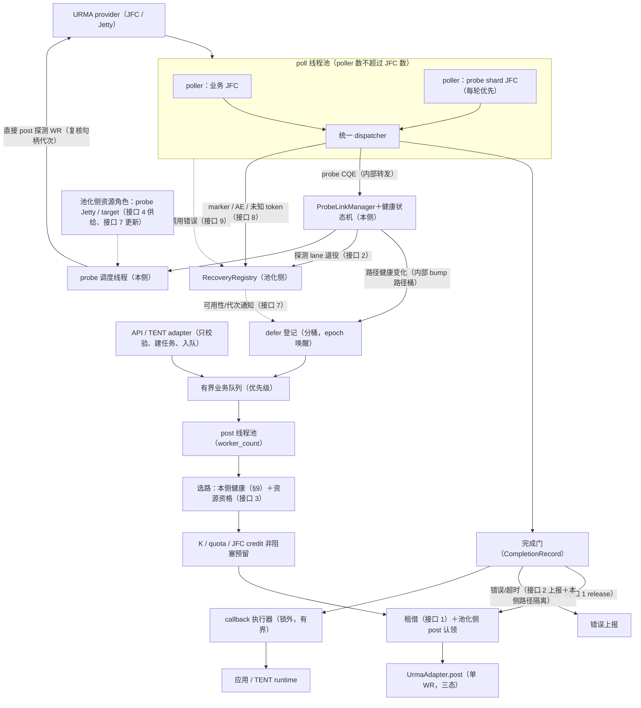
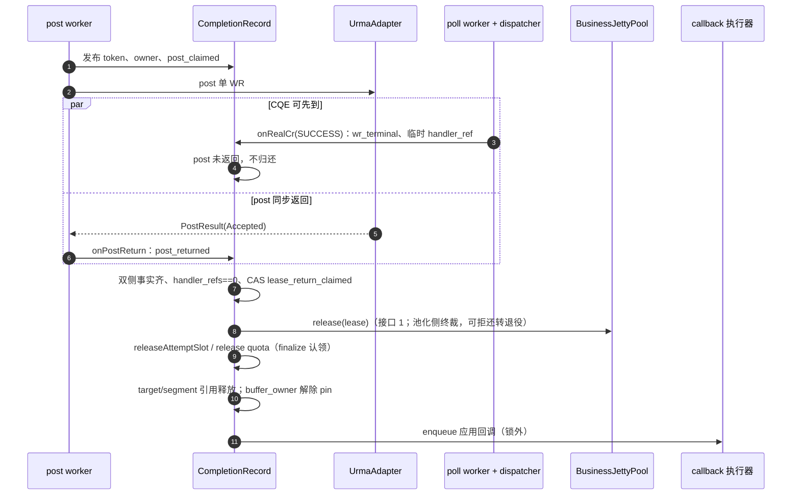
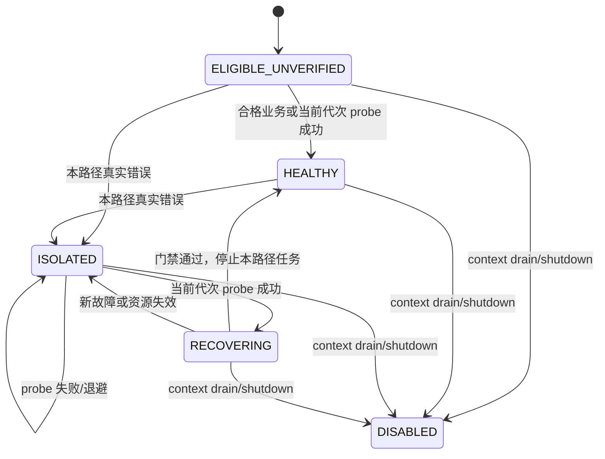

# TENT UB RM post/poll 线程池与完成路径详细设计

> 日期：2026-11-10（修订四）。配套文档：V3 详设《tent-ub-rm-jetty-pool-design》（main_learn，1103 整合版，经核对与 main_learn 11-02 版为同一份）、池化详设《supercache_jetty_pool_current_and_target_rm_concise》（2026-11-03 整合版，池化侧文档，见 §2.2 版本偏差）。
> 代码基线：Mooncake v3 / 956af65e（mooncake-transfer-engine/tent），本文行号均对应该基线；UMDK 参考基线 09086da5（gitcode.com/openeuler/umdk，同级参考，非构建依赖；本地检出 .tmp-umdk/，09086da5 为其祖先，本文引用行号已逐条复核）。
> 状态：设计文档；**W1 链路探测已实现（`probe/enabled` 默认 false）**，其余里程碑待实现。本文覆盖 post/poll 线程池、K 准入、事件分类与分发、完成门与归还、超时扫描、callback 执行器、启停协议，以及**链路探测子系统（健康状态机、campaign、探测调度与探测 WR）**。
> **2026-11-10 修订四**：删除历史决议记录（其有效规则已全部位于正文相应章节），全文移除决议编号引用；实施顺序调整为**链路探测先行**（§13 之 W1）。
> 版本历史：11-04 冻结两侧接口与分工结论（本文为两侧对齐的唯一文档）；11-09 链路探测子系统移入本侧（§9），接口 3/4/6/7 相应调整；11-10 查漏补缺（探测 JFC 模式、探测区 descriptor、参数错误分类、K 默认值、轮询公平性、结果三层语义表、风险与缓解、改造点清单、术语表）；**11-13 按《tent-ub-probe-link-detail-design》§17 回写 W1 实现结论**（超时归属、Pending、业务成功语义、campaign 退出与合并、失败分类、责任不明恢复、关闭顺序、配置键、验收口径、指标）；**11-13 解耦**：明确链路探测不依赖业务 Jetty 池化，独立探测资源供给方案见 [tent-ub-probe-standalone-supply](tent-ub-probe-standalone-supply.md)（§9.1.1）；**11-16 P1–P5**：独立 provider、握手目录、RM poster、退役重建/接口 7、transport standalone 装配与 `probe/provider` 配置已落地（bootstrap 线上字段仍待接入）；**11-16 v1.7 对齐**：探测资源改为本侧自建（发现非 bonding 物理口、自建 probe Context/JFC/Jetty/源页），接口 4/7 只承载远端描述符/邻接/门禁；新增测试模式 `probe/test/*`；新增两节点 `tent_probe_selftest`（JSON 交换、不经 bootstrap）。
> 不在本文范围：Jetty 池化与预算（池化详设 §5）、**全部原生 Jetty 资源角色的退役/删除/补池机械（业务＋探测角色，其 §7）**、RM adapter 迁移与 bootstrap v2（其 §4）、TENT/Store/staging 安全接入（单独指派）。探测子系统原属其 §6，已移入本文 §9。

## 1. 约束语义与设计边界

### 1.1 队列与提交约束

1. 业务队列有界（queue budget）。submit 按 Task 整体准入（all-or-nothing）：**先按可入队 slice 数查容量，容量足够才逐 slice markQueued 并入队**；容量不足时整 Task 返回背压错误，slice 状态不被触碰，不部分入队、不无界堆积、不静默丢弃。slice.h 状态机中 kQueued 无 unmark 路径（只能经 beginAttempt 或 requestCancellation 离开），若先标记后拒绝，被拒 Task 的 slice 将滞留 kQueued 且重试 submit 时 markQueued 全部失败（详见 §5.1 注）。
2. defer（延迟重排）不是失败：pool miss（借不到工位）、K 满、quota 满、credit 不足一律进 defer 登记；不 markFailed、不递增 retry_count、不记路径故障、不临时创建 Jetty、不触发模式回退。
3. defer 登记有界，parked（暂存等待）项计入 queue budget（queued＋parked 总量），不产生第二套无界集合。
4. 资源归还、补池、健康与代次变化**分桶**更新 availability epoch（可用性版本号）并唤醒对应谓词的 parked 调度（§5.4）；stopping 是无条件唤醒源，触发全量回流。禁止定时盲轮询（移除现 workers.cpp:450 的 50µs 盲等）。
5. submit 前 Task 必须 sealed（切片集合封闭）；`UbTask::seal` 只封闭集合，不构成 post 退出或 DMA 屏障。

### 1.2 post 约束

1. 每个 slice（切片）attempt（一次尝试）独立选路；先选路、后从所选 Context 的池租用（`tryAcquireOne`，接口 1），不按组、批次或 endpoint 汇聚；重试创建新 attempt。
2. 每 attempt 最多一次 native post（原生下发），输入恰好一条 WR（工作请求），`next=null`。
3. 准入顺序固定：target/Region 准备 → K → quota → JFC credit（随租借预留）→ lease（租约）→ **池化侧 post 认领（`tryClaimPost`，接口 1）** → native post；任一步失败逆序回滚已持有资源，不持部分资源阻塞等待（V3 §7.2）。record 的 `post_claimed` CAS 仅防本侧对同一 attempt 重复 post；"是否允许 post"的权威判定在池化侧 claim（§5.5）。
4. post 结果采用三态 acceptance（接受状态，接口 5）：`NotAccepted`（确定未接受）才回滚并允许重试；`Accepted`/`Unknown` 不重放；`Unknown` 交排空。真实 CQE 与"确定零接受"冲突时隔离该资源。
5. K（`task_max_inflight_attempts`）约束单个网络 UbTask 跨 Context 的并发 attempt；父请求 C 个 CROSS 子任务可达 C×K；K ≠ 池大小 ≠ staging（中转缓冲）窗口。
6. post worker 不执行 native create/delete/modify/flush，不持 lease 等待 RPC 或握手；缺失 target 由控制执行器异步补齐，该候选本次延后。

### 1.3 poll 与完成约束

1. 每个 JFC（完成队列）唯一正常 poller（收活线程），含探测预留的 probe shard（探测分片）；poller 数 = min(poller_count, JFC 数)。probe shard 在其所属 poller 的轮询序中排首位，控制完成优先于业务批量（§7.1）。
2. 事件先分类再分派：**token namespace（probe/业务/未知）与 AE 类型先行路由；业务 token 内部先 CR flag（完成回执标志位）后 status（状态码）**（UMDK 实机结论，§7.2、§7.2.1）。marker 不按 poll 条数扣 WR/JFC credit。
3. probe CQE（独立 token 编号区间）携带原始 CR 转发**本侧** ProbeLinkManager（接口 6 已内部化），本侧自行解释其健康语义；探测 Jetty ERROR 排空产生的带 flush flag 的 probe 真实 CQE 也走该转发，不进入业务结算（§7.2）。
4. 完成门是归还唯一判据：`post_returned && acceptance == Accepted && 唯一真实 SUCCESS CQE && 旧 handler 不再访问可复用状态 && 未见 fault/retire && pool OPEN && lease_return_claimed`。token 先于 native post 发布；post 返回与 CQE 任意先后，双入口推进同一完成门。本侧完成门判定是必要条件：**"未见 fault/retire && pool OPEN"的最终裁决在池化侧 `release()` 内同步完成**（AE/retire 是池化侧异步状态，本侧 record 的 fault_seen 看不到），release 可拒绝归还并转入退役，归还不得早于 FAULTED 转移（接口 1、§7.4）。**W2 起把归还判据显式拆成三段**：①事实齐（`post_returned`、`acceptance==Accepted`、唯一真实 SUCCESS CQE）；②无 handler 在跑（`handler_refs==0`，由每个作用域的 RAII 守卫维护，最后一个释放者推进门）；③责任证据齐（`wr_terminal` / `fence_proven` / 确定零接受，三选一）＋一次性认领 `lease_return_claimed`。逻辑结果的"决定"与"投递"分离：决定在 `settle_claimed` 认领时一次写成，投递在 owner 释放之后，因此重试不会早于旧资源归还（落地细节见《tent-ub-w2-completion-gate-design》§6）。
5. poll 热路径不调用应用 callback（回调）、不做同步 quiesce（静默排空）、不等待 provider；错误 CQE 后本侧只做三件事：按 token 结算本次业务、上报与隔离登记（接口 2 上报池化侧＋本侧 ProbeLinkManager 路径隔离，均为非阻塞短状态变更）、继续正常轮询。接口 2/7/8/9 的上报调用均为非阻塞入队（有界、合并），不得在 poll 线程同步等待池化侧。
6. JFC 的有限批次软件 flush（冲刷）提取是本侧向池化侧排空协调提供的服务（接口 10），返回记录经同一 dispatcher（分发器），维持 JFC 单消费者不变量；**覆盖业务与探测两类 lane**（§7.6、§9.4）。

### 1.4 超时约束

1. 业务 WR 超时＝首次错误：TimeoutScan（超时扫描）只标记 `timed_out`/`fault_seen` 并走 `beginErrorOnce` 统一上报；工位退役与排空由池化侧推进（其状态机补 LEASED→FAULTED 超时边），本侧不做同步 quiesce。
2. 超时不解除 buffer pin（内存钉住）、不重放：逻辑层以 TIMEOUT 结算、ExecutionOutcome（执行结果）＝Unknown；WR 硬件责任未结束前 K permit、quota、lease 引用不释放。**错误/超时路径不经正常完成门（fault_seen 已置位，完成门永不通过）：K/quota/target/segment/buffer 由 record finalize 一次性认领释放，lease 交池化侧退役处置（§8）**。
3. 同一 slice 的新 attempt 调度必须等旧 attempt 的 CompletionRecord（结算记录）安全终结，复用现有 attempt 一次性提交语义（slice.h 的 beginAttempt/tryCommitPost）。
4. **probe WR 超时＝责任不明**（区别于业务超时＝首次错误）：标记、保留探测源 pin、经接口 2 上报该探测 lane 退役排空；不重发、不因超时把同口其余路径记 BAD（§9.4）。

### 1.5 职责边界

| 本侧不做 | 归属 |
| --- | --- |
| Jetty 创建/租借/归还执行、LIFO（后进先出）栈、预算（业务池） | 池化详设 §5 |
| modify ERROR、flush-done 状态机、DELETE_READY、删除/补池线程（业务＋探测 Jetty 资源角色） | 池化详设 §7 |
| RM adapter 底层（三态 post、RemoteTarget）、bootstrap v2、TargetRegistry | 池化详设 §4 |
| 探测 Jetty 的原生资源角色（创建/退役/删除/补池/预算/tombstone） | 池化详设 §7；本侧仅持句柄与代次（§9.1） |
| TENT/Store/staging 安全接入 | 单独指派 |

（探测子系统逻辑——健康状态机、campaign、探测调度、探测 WR——**归本侧**，见 §9。）

### 1.6 探测与健康约束

1. 探测为业务错误触发、恢复即停：初始化后路径为 `ELIGIBLE_UNVERIFIED`，允许受控业务尝试；合格业务成功可转 `HEALTHY`；不要求启动时常驻周期探测（避免"必须先探测才发业务"死循环）。
2. 健康状态（ELIGIBLE_UNVERIFIED/HEALTHY/ISOLATED/RECOVERING）是 path/probe link 级状态，与业务 Jetty member 状态（池化详设 §5.1）分离，不得混用；HEALTHY 不代表一定有空闲业务 Jetty。
3. 业务错误只隔离对应 PathVersion 并触发该 peer 的唯一 campaign；不自动把同 peer 全部路径置坏；每路径一项任务、同口最多一个在途 probe、每 peer 同时最多一个 campaign。
4. probe WR 为一字节 WRITE，写对端专用授权探测区（独立 token namespace、专用控制额度、真实 JFC credit），不占业务 Task K；WRITE probe 成功不证明业务 READ 权限、任意长度能力或物理端口 GOOD。
5. 恢复门禁：`recover_success_threshold` 固定 1 ＋ 全套代次/门禁校验；旧成功（stale 代次）不解封新故障。
6. 探测 Jetty 的原生生命周期归池化侧资源角色（其 §7，每口一个活跃发送成员）；本侧持句柄与代次、直接 post，post 前复核句柄代次有效（§9.4）。

## 2. 分工边界与协作要点

本节为两侧分工与协作边界，是开工与接口冻结的依据；接口签名与语义见 §11。

### 2.1 分工边界

| 归属 | 内容 |
| --- | --- |
| post/poll 线程池侧（本文档） | 有界业务队列；post 池（选路条件＋分层评分、K/quota/JFC credit 非阻塞预留与逆序回滚、`tryAcquireOne` 单租、单 WR post、三态 acceptance 处理）；poll 池（每 JFC 唯一 poller、事件分类与分发、完成门与归还、token 结算、超时扫描重构）；K 准入实现（`task_max_inflight_attempts`）；callback 执行器；**链路探测子系统：ProbeLinkManager 与健康状态机、peer campaign、probe 调度线程、探测 WR 构造与直接 post、probe token namespace、恢复门禁与逐路径停止；probe 行为配置键（§12）**；deferPending 不加 retry；观测（early_cqe / task_K_wait / unknown_token / poll_pause_us / probe_* 等） |
| 池化侧（同事） | BusinessJettyPool（LIFO 空闲栈、租借、预算）；**全部原生 Jetty 资源角色的生命周期机械（业务＋探测角色：创建、modify ERROR 退役、flush、DELETE_READY、retire/refill 线程、预算、tombstone——其 §7 按角色扩展）**；RM adapter 迁移（三态 post、RemoteTarget）；bootstrap v2；TargetRegistry（含探测 WR 所用 imported target 的供给与代次）；设备 gate 与拓扑配置键 |
| 两侧咬合点 | ①租借/认领与归还（完成门 → release 入 LIFO）②错误上报（业务＋探测 lane 退役统一走接口 2）③选路资源资格查询＋初始化供给（JFC＋probe 资源，接口 3/4）④可用性/代次通知与排空/JFC 协调（接口 7/10） |

### 2.2 配套文档版本偏差（注意）

池化详设《supercache_jetty_pool_current_and_target_rm_concise》为 2026-11-03 整合版，早于当前分工，以下部分已过时，以本文为准：其 §1.3 仍写"poll 线程关闭 PostGate、调用 modifyJetty(ERROR)"（现由池化侧经接口 2 触发推进，poller 只做三件事，§1.3.5）；其 §5.1 状态机与 §11.1 异常矩阵缺"业务超时→FAULTED"行（§1.4.1）；**其 §6（探测 Jetty 与链路健康状态）与 §10.1 之 P1-D 已移入本文 §9/§13，其文档应将 §6 改为引用本文并仅保留探测 Jetty 资源角色部分（§7）**；其 §9.1 的 probe 行为键移至本文 §12（local_ports/adjacency/target_map 等拓扑键保留在其配置表，两侧共用同一配置源）。**两侧文档冲突时以本文与 §11 接口为准。**

## 3. 现状基线与差距

| # | 现状（基线 956af65e） | 目标设计 | 章节 |
| --- | --- | --- | --- |
| 1 | 优先级 deque 无界（workers.h:229） | 有界队列＋分桶 defer 登记＋availability epoch 唤醒 | §4、§5 |
| 2 | poller stride 绑定 JFC，数量 min(poller_count, JFC)（workers.cpp:374-377） | 保留绑定模型，纳入 probe shard 且每轮优先 | §7.1 |
| 3 | post 用 `endpoint->jetty(worker_index)` 选工位（workers.cpp:904） | 选路后 `tryAcquireOne` 租借＋池化侧 `tryClaimPost` 认领 | §5.5 |
| 4 | Inflight 仅 token/引用/超时位（workers.cpp:54-68） | CompletionRecord 13 字段＋完成门（业务与 probe record 共用结构）；**W2 已替换为「共享内核 + 侧挂 owner」** | §7.3、§7.4 |
| 5 | post 二态，靠 posted_count 推断接受（urma_adapter.h:268） | PostResult 三态 acceptance | §6 |
| 6 | 无 K | task_max_inflight_attempts 准入 | §5.3 |
| 7 | 事件 7 类枚举，poller 线程直接回调应用（workers.cpp:1000-1032） | 十类分类＋callback 执行器 | §7.2、§7.5 |
| 8 | 超时同步 quiesce＋fence 后结算（workers.cpp:1035-1105） | 标记＋上报，退役排空归池化侧；probe 超时＝责任不明 | §8 |
| 9 | deferPending 50µs 盲等（workers.cpp:440-466） | 分桶 availability epoch 精准唤醒 | §5.4 |
| 10 | 健康被动：RailMonitor 错误窗口＋cooldown 暂停 | 本侧健康状态机＋campaign；EWMA 保留；接口 3 只查资源资格 | §5.2、§9 |
| 11 | 无探测子系统与 probe 资源 | ProbeLinkManager＋probe 调度线程＋接口 4/7 资源供给 | §9 |

## 4. 资源模型与线程职责

| 组件 | 唯一职责 |
| --- | --- |
| BoundedSubmitQueue | 优先级队列、容量账本（queued＋parked）、all-or-nothing 准入（先查后标记）、背压 |
| DeferRegistry | 分桶 parked slice、等待谓词（桶 epoch/stopping/cancel）、快照复核、脏桶回流 |
| UbTask K slot | 每任务跨 Context attempt 槽位计数，非阻塞获取/释放（slice.h） |
| PostWorker | 选路、准入、租借、池化侧 claim、单 WR post、onPostReturn 推进完成门 |
| PollWorker | 唯一 JFC 消费、批量 poll（probe shard 优先）、喂 dispatcher；有限批次 flush 提取服务；响应 JFC 暂停（接口 10） |
| Dispatcher | 事件分类（AE→namespace→flag/status）、token 路由、probe CQE 内部派发、marker/AE/未知 token 上报 |
| CompletionGate | 每 record 的 8 项事实位、一次性认领、归还/退役判定与 owner 释放顺序（§7.4） |
| CallbackExecutor | 有界队列、锁外调用 slice/task 回调 |
| TimeoutScan | 业务＋probe record 截止扫描（按 deadline 有序结构、按 poller 分区），标记＋上报（无 quiesce） |
| ProbeLinkManager / PathHealth | 合法路径健康状态（§9.2）、fault_epoch、campaign（§9.3）、退避调度与恢复门禁（§9.5）、端口/节点证据契约（§9.6） |
| ProbeScheduler（本侧线程，首版 1 个） | campaign 任务队列（有界、去重合并）、退避定时、同口公平轮转、探测 WR 构造与直接 post、句柄代次复核（§9.4） |
| PathLoadLedger | 在途 WR/字节按 path/target 键聚合（record 发布/终结时维护，不随 endpoint 更换清零），供评分（§5.2） |

锁与有界执行：

- queue/defer/registry/probe 状态锁内只做短状态变更，不跨 adapter、RPC、callback 持有；锁顺序统一为 DeferRegistry → 业务队列 → PathHealth/ProbeLinkManager → record registry，获取顺序固定、不得逆序；任何本侧锁不得与 JFC gate（接口 10）或 UMDK CQ 自旋锁（§7.2.1）嵌套；健康状态发布与 fault_epoch 递增在同一 ProbeLinkManager 同步点（§9.3）。
- CompletionRecord 以原子事实位＋一次性 CAS（比较交换）认领推进，无长临界区。
- 所有队列（业务/defer/campaign/probe 任务/callback）有界；等待均可被 cancel/stop 打断。
- availability epoch 按桶单调递增；仅 bump 对应桶并置回流脏位，多次 bump 合并为一次扫描，不做与谓词无关的无效唤醒。

线程数量：post 池 worker_count（默认 6）、poll 池 poller_count（默认 2，截断到 JFC 数）、callback 执行器首版 1 线程、**probe 调度线程首版 1 个（直接 post 探测 WR，不经 post 池）**；本侧不新增其他常驻线程（删除/补池/控制线程归池化侧；回流由被唤醒的 post worker 执行，§5.4）。

## 5. 提交、选路与准入

### 5.1 提交路径

~~~text
submit(task):
  校验 sealed、accepting
  需要容量 = task 可入队 slice 数（kInitial/kRetryPending 且未取消——只统计，不改状态）
  lock(queue): 总深度（queued＋parked） + 需要容量 <= queue_budget ?
    否 -> 解锁，返回 TooManyRequests（整 Task 背压；slice 状态未被触碰，
          调用方可安全整 Task 重试 submit）
    是 -> 逐 slice markQueued（失败者按取消/终结结算并跳过），
          全部入队，notify
cancel(task): requestCancellation + notify（保留现语义）
~~~

注：现实现（workers.cpp:291-309）先 markQueued 后入队；kQueued 在 slice.h 状态机（slice.h:216-227）中只能经 beginAttempt 或 requestCancellation 离开，无 unmark。若保留"先标记后查容量"的顺序，被拒 Task 的 slice 将滞留 kQueued、无人处理且重试 submit 时 markQueued 全部失败——故容量判定必须先于任何状态变更。

启动校验：`business_queue_budget >= max_slices_per_task`（不足则拒绝启用，§12）。否则 64 KiB × 65536 片（4 GiB）的整 Task 在 all-or-nothing 语义下永远无法一次性准入，大请求将稳定被背压。

### 5.2 候选与评分

候选路径必须同时满足（条件归属按分工划分；资源条件经接口 3 查询，对齐池化详设 §2.3）：

~~~text
本侧健康（§9.2）:    path.health ∈ {HEALTHY, ELIGIBLE_UNVERIFIED}
池化侧资源（接口 3）: target.epoch == current_epoch && context.state == ACTIVE
                     && node/port 设备 gate allows business
                     && business_pool.hasIdle(path.context)
本侧数据面:          Region/profile/注册代次有效（Region 沿用 buildRoute＋buffers；
                     profile 与注册代次经 lease 及接口 3 返回校验）
~~~

评分分层沿用 UbPathSelectionScore 结构（workers.h:53），口径修正：`endpoint_outstanding_*` 两项替换为**本侧 PathLoadLedger** 的 path/target 键聚合在途负载（record 发布/终结时维护、不随 endpoint 更换清零——接替池化侧 PathRegistry/ImportedTargetRegistry 的聚合职责，接口 3 不再附带负载数据）；EWMA（指数加权平均）带宽样本继续由本侧 RailMonitor 维护（recordSuccess/latency 采样保留；**错误窗口与 pause 语义由本侧健康状态机取代——ISOLATED/退避即 pause 的等价物，RailMonitor 不再执行 pause**）。分层顺序：可准入 → 拓扑等级 → 归一化在途 WR/字节 → target 压力 → 有效带宽 → retry_order/稳定设备 ID。

无空闲 Jetty 时按序尝试其他合格候选；全部不足 → defer（§5.4，pool idle 桶）。路径不健康或无合格候选 → defer（路径桶；健康恢复时 ProbeLinkManager 内部 bump 唤醒，§9.2）。缺失 target 的候选本次跳过并由控制执行器异步补齐。

### 5.3 K 准入

~~~text
UbTask（slice.h）新增：
  inflight_attempts（原子计数，跨 Context 统一）
  tryAcquireAttemptSlot(): inflight < task_max_inflight_attempts 时 CAS+1，否则失败
  releaseAttemptSlot(): 两种时机——确定未接受；或 WR 终结且 post/handler 引用退出
~~~

- 获取失败 → defer（K 桶，资源不足语义，非失败）。probe WR 不占 K（§1.6.4）。
- K 释放与 native 预算分层：WR 安全结束即可还 K，不必等工位删除。
- 父请求 C 个 CROSS 子任务贡献 C×K 并发上限，仍受池与设备额度约束。

### 5.4 defer 与 availability epoch 唤醒

epoch 分桶：按首个失败准入步分桶（K 满 / quota·credit 满 / pool idle 空 / 路径不可用），各自单调递增；parked 项记录 (reason, wait_epoch)。**判定顺序固定为"先读桶 epoch、再判条件、登记后复核"**：

~~~text
准入评估（按序，每个条件先读其桶 epoch 再判定）：
  ep = bucket_epoch[K]；tryAcquireAttemptSlot() 失败
    -> 回滚已持资源，deferPending(pending, K, ep)
  （quota/credit/lease/路径资格同理，各持各自桶快照）

deferPending(pending, reason, wait_epoch):
  若 stopping 或 slice 已取消 -> requestCancellation
  否则在 DeferRegistry 临界区内（与回流互斥）：
    若 bucket_epoch[reason] != wait_epoch
      -> 判定期间该桶已变化，不入表，立即回流重试（防丢唤醒）
    否则记入 DeferRegistry[reason]，wait_epoch

onAvailabilityChange(reason):   // 本侧资源释放/健康恢复，或池化侧经接口 7 通知
  bucket_epoch[reason]++
  置回流脏位并 notify（多次 bump 合并为一次扫描；不在 poll 热路径内联全量回流）

回流（单次扫描消化全部脏桶，由被唤醒的 post worker 在取队列前执行）：
  stopping -> 全桶无条件回流；命中 stopping/cancel 谓词者 requestCancellation 结算
  否则仅回流脏桶中 wait_epoch < bucket_epoch[reason] 的项，
  按原优先级回队列并 notify
~~~

- **快照必须在判定前读取**：若 wait_epoch 取"登记时"的当前值，会吞掉"条件判定失败 → 登记入表"之间发生的 bump（唤醒扫描先跑、该项尚未入表），该 slice 将等到下一个无关事件才可能被唤醒——丢唤醒。复核（`bucket_epoch != wait_epoch` 则不入表）精确覆盖该窗口。
- **分桶避免惊群**：一次 K 释放只唤醒 K 桶，不惊动 pool-miss 桶；健康恢复只唤醒路径桶。回流失败的 slice 以新快照重新 park，无忙等、无 retry 递增。全量唤醒仅发生在 stopping。
- parked 项计入 queue budget（§1.1.3）；回流在桶间/队列间保持锁顺序（§4）。

### 5.5 原子准入与逆序回滚

1. 准备已验证 endpoint、imported target 引用（经池化侧 registry）与 Region（沿用 buildRoute＋buffers 查找）。
2. 非阻塞依序预留：K slot → device/path quota（QuotaManager 既有 tryAcquireFirst）→ JFC credit（tryAcquireOne 内预留）。
3. `tryAcquireOne(path)` 成功得 JettyLease（绑定 AttemptKey＋LaneKey＋PathVersion）。
4. 发布 token 与全部 owner；随后调用接口 1 的 `tryClaimPost(lease)`：池化侧在其 PostGate ticket/close 的**同一同步域**内复核 stopping、PathVersion、fault_epoch、target/注册代次，原子返回 `Claimed` 或 `GateClosed(原因)`；`Claimed` 后本侧以 record CAS `post_claimed` 防双发，随即执行唯一 native post。
   - claim 必须落在池化侧：fault_epoch/PostGate 是池化侧状态，本侧 record 的 CAS 无法与 gate close 线性化；"close 不作废已认领 ticket、作废未认领 ticket"的语义由池化侧在同一临界区定义（对齐 V3 §7.2.5、池化详设 §5.2.3）。否则存在窗口：路径已被隔离（如同路径另一 WR 出错、fault_epoch++），本 attempt 仍向已隔离路径 post。
   - 注：fault_epoch 的权威计数在**本侧** ProbeLinkManager；`tryClaimPost` 复核时由池化侧经共享的 PathVersion/fault_epoch 视图（初始化供给与接口 7 代次通知同步）比对，或由本侧在 claim 前附带当前 fault_epoch 快照——采用后者：`tryClaimPost(lease, fault_epoch_snapshot)`，池化侧比对期别即可，不引入反向查询。
5. post 单 WR（§6）。
6. 任一步失败逆序回滚：撤销 post 认领 → 释放 lease → 释放 quota → 释放 K → 撤销已发布 token；全程不持部分资源等待。
   - `GateClosed` 同样逆序回滚；slice 记 defer（路径/池对应桶），不消耗 retry——关闭该 gate 的隔离/代次事件本身会 bump 对应桶并唤醒重试。

## 6. post 执行与三态 acceptance

~~~text
PostResult post(jetty, target, work_request)   // 接口 5
  status / acceptance: NotAccepted | Accepted | Unknown / posted_count ∈ {0,1}
~~~

| acceptance | 处理 |
| --- | --- |
| NotAccepted | 逆序回滚（§5.5）；slice 走 resolveBeforePost 失败路径——这是真实失败，retry 计数正常消耗（区别于 pool miss 的 defer） |
| Accepted | record.acceptance=Accepted；onPostReturn 置 post_returned；与 CQE 侧共同推进完成门 |
| Unknown | 不回滚、不重放、不释放 lease；上报 beginErrorOnce 交排空（工位退役）；record 保留至硬件责任终结。**W2 过渡态**：接口 2 尚未接入，Unknown 不发起退役，只能阻塞到超时扫描的 fence（阻塞期间计 `gate_blocked_by_acceptance`）；`legacyAcceptance()` 由 `posted_count` 推导，`Unknown` 只由自相矛盾的 `posted_count > 1` 产生 |

- token 在 native post 前发布进 registry；post 调用栈强持有 record（handler_refs＋1），返回即 `onPostReturn(record, result)`。
- WR 构造：operation、地址、token、target 引用、segment 引用；恰好一条，next=null。
- 旧 vector 版 post 接口在 pooled RM 下必须断言长度 1；不得以 posted_count 推断接受状态。

## 7. poll、事件分类与完成门

### 7.1 poller 绑定与循环

- 初始化经接口 4 取 JFC 清单（含 probe shard），stride 分配：poller i 负责 JFC[i], JFC[i+N], …。
- **probe shard 排其所属 poller 轮询序首位，每轮必先 poll**：控制完成（probe CQE、marker）延迟上界＝一轮批量 poll，不受业务 JFC 满载挤压；业务 JFC 之间保持 stride 顺序。首版不设专职 probe poller；实机测得控制延迟超标再升级为专职。
- 循环：批量 poll（默认 64）→ 逐条喂 dispatcher → 每 1ms 一次 TimeoutScan（CAS 幂等，可优化为单扫描者）→ 无进展 sleep 20µs（保留现退避；JFCE 事件驱动列为后续优化）。
- **轮询公平性**：单次循环不得被单个 JFC 长期占满——每 JFC 每轮至多一批（64），业务 JFC 依 stride 顺序轮转，连续无进展的 JFC 不得挤压同 poller 的其他 JFC；上线前实测各 JFC 完成延迟 p99。
- poll 返回错误：经接口 9 按 context 故障上报池化侧（现 handleLocalDeviceFailure 入口，workers.cpp:381，改接池化侧），本侧不重建资源。
- poller 响应接口 10 的 JFC 暂停：每轮开始前检查本 poller 各 JFC 的 pause 标志，命中则跳过该 JFC 并确认已退出其临界区（记录 poll_pause_us），恢复后继续。

### 7.2 事件分类（判定顺序固定）

~~~text
onCompletion(cr):
  1. CR 类型为 AE
       -> 按实体经接口 8 上报池化侧并按 API ACK；不当业务 token
  2. token ∈ probe namespace
       -> 原始 CR 转发本侧 ProbeLinkManager（接口 6 已内部化；
          PLM 自行按 flag/status 语义解释；stale 只结算旧责任，不更新当前健康；
          真实 probe 错误另经接口 2 上报探测 lane 退役，§9.4）
  3. token ∈ 业务 registry
       3a. cr.flag.bs.flush_err_done / suspend_done == 1
            -> 真实 WR（user_ctx 有效）-> 按 token 路由结算      [urma_types.h:1139-1140]
       3b. 未置位而 status == URMA_CR_WR_FLUSH_ERR_DONE / URMA_CR_WR_SUSPEND_DONE
            -> 实体 marker（user_ctx 无效）-> 经接口 8 按 JFC/实体类型/
               local_id 上报池化侧（ERROR 代次由池化侧按其 RecoveryRegistry
               归属）；不扣 WR credit                          [udma_u_jfc.c:756-763]
       3c. 其余 -> 按 status 结算：SUCCESS / 首次真实错误（含 WR_FLUSH_ERR）/ WR_UNHANDLED
  4. 未知 token
       -> unknown_token++ 记账并经接口 8 上报诊断（kind=unknown_token，
          携带 JFC/local_id 线索，供池化侧 tombstone/事件屏障归因）；
          不崩溃、不清除其他责任
~~~

判定顺序说明：

- **namespace/AE 先于 flag/status**：探测 Jetty ERROR 排空时，其 in-flight probe WR 的 CQE 带 flush_err_done flag（真实 WR、user_ctx 有效）；若先走业务 flag 分支，probe 真实 CQE 会漏进业务结算路径。probe token 一律转发本侧 PLM。
- **业务 token 内部先 flag 后 status**：status 枚举的同名值是硬件伪造假回执（urma_opcode.h:152-153），CR flag 位域的同名 bit 却标记真实 WR——不可凭名字清 token。

十类完整枚举（W4 验收依据；各类语义细节另见 V3 §10.1 与池化详设 §7.1，下表为其在本侧的执行展开）：

| # | 类别 | 判定特征 | 处置 |
| --- | --- | --- | --- |
| 1 | SUCCESS | 业务 token，无 marker flag/status | 完成门推进，EWMA 采样 |
| 2 | 首次真实错误（含 WR_FLUSH_ERR） | 业务 token，status 错误类 | token 结算＋beginErrorOnce（接口 2）＋本侧路径隔离/触发 campaign（§9.3） |
| 3 | CR flag 陷阱真实 WR | flag.bs.flush_err_done/suspend_done 置位 | 按真实 token 结算，不清 token |
| 4 | 实体 flush-done marker | 无 flag，status=FLUSH_ERR_DONE，user_ctx 无效 | 接口 8 上报，不扣 WR/JFC credit |
| 5 | 实体 suspend-done marker | 无 flag，status=SUSPEND_DONE，user_ctx 无效 | 接口 8 上报 |
| 6 | WR_UNHANDLED（软件 flush 取出） | urma_flush_jetty 提取，user_ctx 有效（udma_u_jfs.c:1171/1208） | 经 dispatcher 按真实 token 结算，不计成功 |
| 7 | AE | CR 类型为异步事件 | 接口 8 实体上报＋API ACK |
| 8 | probe CQE | token ∈ probe namespace | 转发本侧 PLM（含带 flag 的真实 CQE）；真实错误另报接口 2 |
| 9 | 未知/迟到 token | 不在业务 registry | 记账＋接口 8 诊断上报 |
| 10 | poll 调用错误 | poll 返回非 OK | 接口 9 context 故障上报 |

#### 7.2.1 UMDK 实机核验依据（基线 09086da5，本地 .tmp-umdk/）

| 事实 | 源码出处 | 影响 |
| --- | --- | --- |
| status 枚举 `URMA_CR_WR_FLUSH_ERR_DONE / SUSPEND_DONE` 是硬件伪造的假 CQE（user_ctx 无效）；CR flag 位域里同名 bit 却是真实 WR（user_ctx 有效） | urma_opcode.h:152-153；urma_types.h:1139-1140 | 业务 token 分类必须先看 flag 位再看 status，不能凭名字清 token |
| send CQE 的 fd 位置 1 → status 改写为 FLUSH_ERR_DONE、置 queue->flush_flag，且不消费 wrid、不推进 ci | udma_u_jfc.c:756-763 | marker 不占 WR/JFC credit 的实机机制 |
| `flush_jetty` 必须 flush_flag 已置位才取得出；取出记录 status=URMA_CR_WR_UNHANDLED 但 user_ctx 有效 | udma_u_jetty.c:628；udma_u_jfs.c:1171,1208 | 排空两步铁律：先 poll 到 flush-done，再软件 flush；UNHANDLED 走统一 dispatcher 结算、不计成功 |
| delete 失败分支仍把工位从对象表移除 | udma_u_jetty.c:379-380 | "API 返回失败 ≠ 句柄完好"；三分类（RETAINED/CONSUMED/UNKNOWN）必须处理；迟到 CQE 落 "jetty destroyed" 分支属正常 |
| `clean_jfc` 与 poll 用同一把 CQ 自旋锁摘除/压缩 CQE | udma_u_jfc.c:1024-1079；:857 | poller↔删除线程排他协调（接口 10）的底层依据；上层锁不得与该锁嵌套 |
| 探测 WR：URMA_OPC_WRITE、complete_enable=1、next=null、1 字节 payload，注册区整页 | bondp_dp_health.c:29-36,431-444 | payload=1 ≠ 注册长度 1（ummu_grant 要求页对齐）；本侧探测 WR 构造依据（§9.4） |
| UMDK 为常驻周期探测（默认 1000ms，任务自我重排） | bondp_dp_health.h:24；bondp_dp_health.c:515-530 | 只参考 WR/邻接/事件原语，不照搬启动时机与同步重建 |

### 7.3 CompletionRecord（接口 5，两侧共用）

~~~text
CompletionRecord（共享内核；W2 已落地，见《tent-ub-w2-completion-gate-design》§5.1）:
  身份（发布后不可变）: token, kind, attempt_id/attempt_serial,
                        path{local_nic,segment_id,remote_nic}, jetty_generation,
                        topology_epoch / target_epoch / fault_epoch
  状态位（写者唯一）:   post_claimed, post_returned, acceptance, wr_terminal,
                        fence_proven, timed_out, fault_seen, handler_refs,
                        logical_outcome, orphan_reason
  认领位（一次性）:     cr_claimed, settle_claimed, reject_claimed, finalize_claimed,
                        lease_return_claimed, fault_reported, conflict_claimed
  owner（侧挂，业务填）: jetty_lease, target_ref, segment_refs, quota_reservation, buffer_owner
~~~

- CompletionToken 进程内唯一，不复用对象地址；probe 与业务 token 分段编号。
- **共享内核 + 侧挂 owner**（W2 落地形态）：内核只放身份与一次性事实位，不含任一侧私有类型；业务 owner 在 `BusinessRecord`，探测 owner 在 `ProbeRecord` 的其余字段（其 `core` 即本结构）。两侧各自把身份映射进 `RecordPath`（业务 `UbPostPath`、探测 `PathVersion`），内核只认标量。
- **责任证据**：`wr_terminal`（真实 CQE）/ `fence_proven`（quiesce 成功）/ 确定零接受（`NotAccepted`）三者之一，才有资格释放 owner；`fault_seen` 单独不构成证据，`timed_out` 只是暂定标记（fence 失败时撤销）。
- **决定与投递分离**：逻辑结果在 `settle_claimed` 认领时一次写成；owner 释放、`handler_refs` 归零之后才由 owner 处置出口投递，因此重试不可能早于旧资源归还。
- 每个一次性动作各自一个认领位；重复完成靠**认领**而非读事实位判定（`cr_claimed` 保护 `terminal` 写入），重复 CQE、迟到 marker 只结算既有责任。`handler_refs` 只做门判定，不参与生命周期（`shared_ptr` 保证存活）。
- owner 字段（lease/target/segment/quota/buffer）的释放顺序见 §7.4。
- **probe record 复用本结构**：探测的 `ProbeRecord.core` 即本结构；`core.finalize_claimed` 对应 W1 的 `settled`、`core.timed_out` 对应超时标记，lease/K/quota 字段空置、buffer_owner＝探测源页 pin；probe record 不走业务完成门与 lease 归还（§9.4）。

### 7.4 完成门与双入口

- 正常归还条件见 §1.3.4（verbatim 执行）。本侧判定为必要条件；**最终裁决在池化侧 release()**：release 在其同步域内复核成员 FAULTED/retire 状态，可拒绝归还转退役——归还不得早于 FAULTED 转移（V3 §8、池化详设 §5.2）。
- **责任证据（W2 起显式化）**：`wr_terminal` / `fence_proven` / 确定零接受三选一，缺一不得释放任何 owner；`fault_seen` 只是逻辑标记（见 §7.3）。超时与故障路径因此与正常归还互斥，资源由 finalize 的一次性认领释放。
- **registry 删除权（W2 起）**：删除只发生在完成认领方——实现上是 owner 处置完成时删（`onOwners`）。post 侧只写事实位、永不删表（唯一例外：`NotAccepted`，WR 未发出不可能再有完成）。删除点不放在 `wr_terminal` 置位时，以便"记录仍在表内=重复完成（`duplicate_cr`）"与"记录已不在表内=未知 token（`unknown_token`）"可区分。
- owner 释放顺序（正常路径）：`release(lease)`（接口 1，池化侧裁决）→ releaseAttemptSlot / release quota（finalize 一次性认领）→ target_ref/segment_refs 引用释放 → buffer_owner/pin 解除（以 WR 终结且 handler 退出为准，先于 callback 通知；READ 目的缓冲此刻起对应用可见）→ callback 入队。staging 槽位等复合 owner 的安全完成语义由单独指派的 TENT/Store/staging 接入项细化（§1.5），本文只固定顺序与归属。
- 首次真实错误（token 结算后）：fault_seen 置位 → 上报 `beginErrorOnce(LaneKey, jetty_generation, error_epoch, PathVersion)` → **本侧 ProbeLinkManager.onBusinessPathError（PathVersion 隔离、fault_epoch++、触发/合并 campaign，§9.3，非阻塞）** → lease 不归还，交池化侧退役；K/quota/target/segment/buffer 由 finalize 按 §1.4.2 释放。一次性认领保证不重复上报。
- **明确的本地参数/长度/权限错误**：接口 2 上报与成员一次性退役照常，但**不触发路径隔离与 campaign**；slice 按请求错误结算（FAILED、返回原因、限速告警），不进入"探测成功→重试"循环；错误码清单阶段零冻结。
- WR_UNHANDLED（软件 flush 取出，user_ctx 有效，udma_u_jfs.c:1171/1208）：按真实 token 结算，不计成功（probe token 则由 PLM 结算旧责任）。

### 7.5 callback 执行器

- 有界队列；满时背压并告警（完成事实已在 record 终结，仅通知延后，不丢失）。
- 锁外执行 slice resolveAttempt / task 推进，不阻塞 poller；shutdown 时排空后退出。

### 7.6 软件 flush 提取服务

- 池化侧排空协调经接口 10 请求本服务：`requestFlushExtraction(lane_key, error_epoch)`；poller（或持消费 lease 的授权任务）对该 lane 调 urma_flush_jetty，有界批次（首版 16/批）直至取空，结果经 dispatcher 按真实 token 以 WR_UNHANDLED 结算（十类之 6；probe token 转发 PLM 结算）。
- **取空后本侧经接口 10 回执 `onFlushDrained(lane_key, error_epoch, count)`**——池化侧以该回执作为其 DELETE_READY 条件"必要软件 flush 已取空并统一分发"（其 §7.1.7）的证据；没有该回执，池化侧无法判定排空收敛。
- 提取前提：该 lane 已观测 flush-done marker（flush_flag 机制，udma_u_jetty.c:628——未置位时 flush_jetty 返回 0，取不出任何记录）；空 poll 不是屏障。
- 与删除线程的 JFC 排他由接口 10 的 `requestJfcPause`/`resumeJfcPoll` 协调（底层依据：clean_jfc 与 poll 共用 CQ 自旋锁，§7.2.1）；本侧在协调窗口暂停对应 JFC 轮询并记录 poll_pause_us。**服务覆盖业务与探测两类 lane**（探测 Jetty 退役同样需要 flush-done→提取→取空回执链）。

## 8. 超时扫描（TimeoutScan）

- 扫描节奏沿用每 poller 1ms（workers.cpp:404-409 保留）；**扫描数据结构改为按 deadline 的有序集合（最小堆/时间轮）**，替代现 inflight_ 全表线性扫（workers.cpp:1042 对 unordered_map 全扫；queue budget 放大到数万 slice 后，2 poller × 每毫秒全扫代价不可接受）。扫描集合按 poller 分区（record 归属其 JFC 的 poller），两 poller 不重复扫同一集合。**probe record 不纳入 poller 超时扫描**：探测完成超时归 ProbeLinkManager 的调度线程（§9.4，决策 D-3），截止取 probe/timeout_ms；业务 record 仍在 poller。
- 业务 record 命中处理（替换 workers.cpp:1035-1105 的同步 quiesce 段）：
  1. `timed_out` 一次性 CAS 置位；
  2. `fault_seen` 置位，上报 `beginErrorOnce`（超时＝首次错误）＋本侧路径隔离/触发 campaign（§9.3）；
  3. 逻辑结算 TIMEOUT、ExecutionOutcome=Unknown：默认不自动重试，重试决策上移并遵循 Unknown WRITE 不重放、READ 目的内存保护（V3 §17.1）；
  4. record 保留至硬件责任终结（真实 CQE 或 flush 证据）；**届时 K/quota/target/segment/buffer 由 record finalize 一次性认领释放（错误/超时路径不经正常完成门，见 §1.4.2）；lease 已交池化侧退役处置**。
- **probe record 命中处理（责任不明，§1.4.4）—由 PLM 调度线程扫描**：`timed_out` 一次性 CAS 置位 → 保留探测源 pin 与当前代次端口槽 → 经接口 2 上报该探测 lane 退役（同口其余路径记 Pending，不记 BAD，§9.4）→ 不重发 → 移入孤儿表；record 保留至硬件责任终结（迟到完成或新句柄代次）后由 finalize 释放源页/探测页引用与控制额度。
- 自然 CQE 迟到到达已超时 record：只终结硬件责任，不二次结算逻辑结果（finalize 一次性）。
- WaitExpired 不解除 buffer pin（业务与探测同）。
- **W2 过渡态（已落地）**：保留同步 quiesce，但只对 `handler_refs == 0` 的记录执行 fence；`post` 尚未返回的记录本轮跳过并计 `timeout_deferred_by_post_return`（下一轮 1ms 后重试）。fence 失败沿用基线：撤销 `timed_out`、保留 token 与全部引用、下轮重试。故障副作用（rail 记账 / PLM 路径隔离 / 成员退役）不在标记处认领，而在随后完成门的 `onFault` 一次性认领——否则"fence 失败撤销超时 → 之后到达真实错误 CQE"会丢掉 rail 记账与成员退役。**已知代价**：`adapter->post()` 若在 provider 内永久阻塞，该记录不会被超时扫描 fence（只能等 `stop()`，而 `stop()` 同样要先 join posting 线程），见 §13.1 风险表；出口留 W5。

结果与资源安全三层语义（LogicalState / ExecutionOutcome / ResourceSafety，对齐 V3 §17.1；W2/W5 验收依据）：

| 场景 | LogicalState | ExecutionOutcome | ResourceSafety | 动作 |
| --- | --- | --- | --- | --- |
| post 确定未接受 | FAILED（可重试） | NotExecuted | Safe | 逆序回滚，新 attempt 重试（消耗 retry，§6） |
| 接受后 CQE 错误 | FAILED | Unknown/Failed | 待排空 | 隔离路径＋成员退役；重试不与旧 DMA 重叠 |
| SUCCESS | COMPLETED | Succeeded | Safe | 完成门归还（§7.4） |
| 业务超时无 CQE | TIMEOUT | Unknown | Unproven | 超时＝首次错误链条（本节）；不自动重放；K/quota/pin 保留至责任终结 |
| cancel 在途 | CANCELED | Unknown | Unproven | 同超时：等 CQE/屏障，finalize 释放 |
| cancel 未 post | CANCELED | NotExecuted | Safe | 丢弃，不占 lease |
| Unknown WRITE | 上层决定 | Unknown | Unproven | 不把 fence 当"未执行"；仅幂等/独占契约下重试 |
| READ 重试 | 上层决定 | NotExecuted/Unknown | 旧 DMA 须先停 | 旧尝试不得再写同一目的 |

## 9. 链路探测子系统与健康状态机

> 本章承接池化详设 §6 与 V3 §13/§14 的探测逻辑部分；探测 Jetty 的原生资源生命周期保留在池化侧（其 §7 按角色扩展）。UMDK 参考事实见 §7.2.1。
>
> **W1 详细设计与实现状态见《tent-ub-probe-link-detail-design》**：W1a–W1d 已实现（默认 `probe/enabled=false`）；真实链路联调依赖 **probe provider（探测资源独立供给）** 与**逐 WR target 的 adapter 能力（或 RC 退化）**，以及接口契约结论（该文 §16 十一点），不由业务 Jetty 池化阻塞。

### 9.1 探测资源与归属

- **每个 local_port 一个专用 probe Jetty**：原生生命周期（创建、modify ERROR 退役、flush、删除、补池、预算、tombstone）归**独立的探测资源供给方（probe provider）**；dedicated 模式不租借业务 Jetty 池、不占业务 lease/K/quota，可与池化侧同进程部署但接口独立；refill 每口只发布一个活跃探测发送成员；**使用归本侧**——句柄与代次经接口 4 初始化供给，重建后经接口 7 更新（`kProbeHandleReplaced`，携带新句柄、源页与新代次）。
- probe Jetty 固定归属本端口与 probe shard JFC slot，不进业务池、**不做本地 RC bind（RM 模式前提）**；探测 WR **逐 WR 指定远端 probe Jetty（identity/uasid）**，不依赖本地绑定（决策 D-2）。探测页是**独立注册、独立 token、独立 import** 的一页内存，不复用业务数据 segment 的授权；import 按 `(ContextKey, target)` 去重。
- **探测完成队列默认 dedicated probe JFC（每 Context 一个，深度 64；建议向 probe provider 申请 send-only，省 JFR 与 `max_jfc` 预算）**，业务与探测完成队列隔离；预算受限时可切 shared 业务 JFC＋预留 credit（probe/credit_reserve）——两种模式均由 probe provider 创建、经接口 4 供给；**本侧只 poll，不拥有、不删除该 JFC**。
- **本端探测区页每口一页**：供对端写入 1 字节，remote-write 权限＋probe token，由 probe provider 注册并经握手发布；`area_epoch` 随探测通道代次。
- **对端探测页每 remote target 一页一槽**（决策 D-4）：descriptor 至少含 address/length/token/epoch，由对端注册、probe provider 经接口 4 供给；多口并发写同一页同一字节是安全的（payload 常量、无读回语义），因此不必每路径一槽。
- **探测源页按 generation 隔离**：每个探测通道代次使用独立源页（`source_generation`）；旧代孤儿在终结或移交前不得注销，避免旧 WR 与新 WR 共享源内存。
- **ProbeLink** 每条固定携带：peer_id, local_port, local_probe_jetty（句柄＋代次）, remote_port, remote_target_identity/epoch, topology_epoch, probe_key, health_state, next_probe_time, backoff, success_count, failure_count。探测链路数 = 合法邻接边数 = Σ degree(local_port)（4 口→8、6 口→12，按配置动态计算，禁硬编码）；两方向分别建表。
- **探测 import 按 `(ContextKey, target)` 去重**（对齐池化详设 §1.2）：共享 Context 时导入句柄数可小于链路数。**4 口 8 条链路 ≠ 8 个远端 target（对端按口发布 4 个共享 target）≠ 8 个探测 Jetty（本端 4 个）**，三者不得混用。
- 探测 WR 使用独立 token namespace（分段编号，§7.3）；专用控制额度与 probe shard JFC credit 由接口 4 供给时预留（probe provider"探测预留控制 credit"）；本侧调度器 post 前非阻塞占用、终结释放。**每口单在途使额度需求恒为 1**。probe 不占业务 Task K（§1.6.4）。

#### 9.1.1 与 Jetty 池化的关系（解耦结论）

链路探测**不依赖业务 Jetty 池化**。v1.7 起这些资源由**本侧自建**：adapter 枚举措物理口（过滤 bond，`probe/device_filter` 可收窄）、每口自建 probe Context/JFC/Jetty/源页；接口 4/7 只承载远端 target/探测页描述符 + 邻接 + 门禁，接口 2 不再承载探测 lane 退役。当前实现见 `StandaloneProbeResourceProvider`（发现/自建/自退役重建）与 `HandshakeProbePeerDirectory`（远端 import）。

dedicated 模式只需要：每本地口一个专用 probe Jetty、一个 probe JFC、一页探测源页、对端探测页 descriptor、远端 probe Jetty identity、拓扑/邻接/代次与 poller 线程；这些都不是业务池资源，也不经 lease 租借、K 准入、quota、endpoint Jetty 集合、RC bind 或补池预算。

真正的硬依赖只有四条：

1. adapter 的**逐 WR target** 能力（RM；若仍为 RC，则退化为"每路径一个已绑定 probe Jetty"，见 [tent-ub-probe-standalone-supply](tent-ub-probe-standalone-supply.md) 的 RC 退化）；
2. **本端探测区页的发布 + 对端探测页 descriptor/远端 probe Jetty identity** 的握手（bootstrap 扩展）；
3. 设备/拓扑/邻接/代次的供给；
4. 完成队列的 poll 线程（复用现有 poller）。

shared 模式（业务 JFC + `credit_reserve`）才借用业务完成队列与预留额度，属于可选模式，不是默认路径。

**资源归属**有两种等价落地，均与业务池无关：

- **A（过渡，改动最小）**：由池化侧提供一个**仅探测角色**的 provider（只创建/退役 probe Jetty/JFC/源页、维护探测页 import），不经过业务 Jetty 池；适合复用池化侧已有的 bootstrap/设备生命周期。
- **B（最终解耦形态，P2 后推荐）**：本侧实现独立 `StandaloneProbeResourceProvider`，直接通过 adapter 建探测资源，对端握手单独定义；探测进度不再依赖池化侧排期。

两种方案都落在现有 `ProbeResourceProvider`/`ProbePoster` 缝上；PLM、调度器、workers 接缝与 W1 单测无需改动。落地拆分、握手字段与 RC 退化方案见 [tent-ub-probe-standalone-supply](tent-ub-probe-standalone-supply.md)。

### 9.2 健康状态机（path/probe link 级）

- 初始化后 `ELIGIBLE_UNVERIFIED` 允许受控业务尝试；**合格业务成功只能把 `ELIGIBLE_UNVERIFIED` 提升为 `HEALTHY`，不能解除 `ISOLATED`/`RECOVERING`**（早于故障、迟到的成功不得覆盖新故障）。`HEALTHY` 表示当前代次证据和门禁均通过，**不代表一定有空闲业务 Jetty**（容量语义归池化侧）。
- INVALID/REMOVED 是拓扑资格，不通过探测恢复；配置/邻接变化走新 topology_epoch 代次流程（池化侧发布、接口 7 通知），旧 PathKey 不原地改写。
- 业务错误只影响对应 `PathVersion`（fault_epoch++，本侧权威计数），不自动把同 peer 全部路径置坏；为该 peer 创建或合并唯一 campaign（§9.3）。**同一隔离路径的重复业务错误幂等**：不抬代次、不重复合并 campaign（否则在途探测永远 stale，路径无法恢复；在 W1 未接入选路过滤时尤其关键）。
- `ISOLATED` 使用周期＋指数退避探测；成功重置 backoff；当前有效 probe 成功 → `RECOVERING`；门禁通过 → `HEALTHY` 并停止该路径周期任务（stop_on_recovery 固定 true）；后续新故障可重新激活。
- 健康状态是 path/probe link 状态，与业务 Jetty member 状态（池化详设 §5.1）分离，不得混用。
- 故障域按实际共享域处理：**路径类失败**（远端路径错误、ACK 超时）隔离该路径并经接口 2 退役探测 lane；**lane/配置类失败**（本地设备、flush/suspend、内存/权限、未知）只退役 lane＋同口 Pending，**不记路径 BAD**；JFC/Context fatal 才升级 Context DRAINING（经接口 8/9 上报池化侧处置）；共享 target 故障由池化侧处置（撤销发布、入站屏障、新 epoch），经接口 7 通知本侧暂停/更新全部引用路径。
- **Pending 是探测调度标志，不是业务状态**：lane 退役/端口撤销/context 故障时该口路径记 Pending（携带原因与 `pending_since_ns`），只表示"暂时发不出探测"；业务可用性只由 ISOLATED/DISABLED 决定。
- 状态恢复时 ProbeLinkManager 内部 bump 路径桶 availability epoch，唤醒因此 defer 的 slice（§5.4）。

### 9.3 campaign（业务错误触发的 peer 核验）

1. 首次业务错误：原子隔离实际出错 PathVersion、递增其 fault_epoch；为该 peer 创建或合并**唯一 campaign**（同一时刻每 peer 最多一个），快照其当前全部合法路径。明确的本地参数/长度/权限错误除外（不隔离、不触发 campaign，成员一次性退役后按请求错误返回原因）。
2. 快照内每条路径获得一次受限核验任务（每路径一项，队列有界、去重合并）；未出错路径保留原资格，不被批量置故障。**合并 = campaign_epoch++，并给该 peer 除"在途核验项"外的全部路径重新 upsert 为 QUEUED（due=now）；在途核验项按旧 epoch 结算、整条跳过**。条目收敛按 `campaign_id`+`entry_epoch` 过滤；周期项固定 `(0,0)`，永不命中 campaign 条目。
3. 某路径核验失败 → 独立隔离＋周期退避；未发出、资源不足（控制额度/JFC credit）、probe Jetty 出错造成的取消记 **Pending/Unknown**，不记该路径物理故障。
4. 当前有效探测成功且门禁满足（§9.5）→ 恢复该路径并停止其周期任务。
5. **campaign 退出只看条目终态**：所有条目进入 OK/FAIL/CANCELED 且无 QUEUED/INFLIGHT → 退出；**不等 RECOVERING**（门禁未过的路径由自身周期重探与接口 7 推进）。campaign 可因资源不可用（lane 退役/端口撤销）挂起，等接口 7 重建，用 `campaign_waiting_for_event` 观测。新的业务错误在退出后创建新 campaign（id 递增），不会复活旧条目。
6. **消除"旧成功覆盖新故障"**：ProbeKey 含 topology_epoch＋peer/target incarnation＋fault_epoch＋campaign_id＋probe_sequence；恢复发布与新错误在同一 ProbeLinkManager 同步点比较完整 ProbeKey；排队未 post 的旧任务丢弃，已 post 的旧探测保留 record 到安全完成但结果只结算旧责任、不恢复资格；新故障与恢复发布使用同一线性化规则，避免 timer cancel 后丢失新故障。
7. 探测成功但其他门禁仍阻断 → 留 `RECOVERING`，由控制核验继续推进；不直接取消全部进展责任造成永久停滞。

### 9.4 探测执行与调度

- **probe 调度线程**（本侧，首版 1 个）：计算到期动作、直接 post、处理 post 结果、扫描完成超时，并在 `nextDeadline` 上条件等待（线性扫描＋条件变量即可，路径数上界为 Σdegree）；不占 post 池；同口多个 peer/path 公平轮转，不同口并行。
- **每个 ProbeResource（本端口）最多一个在途 probe**（含 post 未退出或责任不明阶段）：两个 target 的探测不同时占同一发送队列，避免其一故障使同口多个在途探测被连带 flush。该串行约束只作用于探测资源，不把业务 slice 聚成组。**peer_budget（默认 4）** 是同一 peer 跨口的在途上限；超时转孤儿时随记录释放其预算，避免累计 4 次超时让整个 peer 不可调度。
- **端口槽按 generation 作用域**：`slot_token` 只约束"当前这一代探测通道"；lane 退役后槽保持占用（不重发），接口 7 新代次到达时归零，旧在途记录转入孤儿表（按 token 索引，保留源页/探测页引用），迟到的完成只结清资源、不发布健康。
- **provider 侧退役实现（P4）**：quiesce 旧 Jetty 并派发其完成 → reset/delete → 同一 JFC 建新 Jetty/源页/探测区页（generation+1）→ 接口 7 `kProbeHandleReplaced`；旧代页面保留在 retired 列表（与 quarantine 一起）到关闭，重建时不注销。需 completion/availability sink；transport 在 P5 注入。
- probe WR 构造（UMDK 实机依据，§7.2.1）：标准 WR，`URMA_OPC_WRITE`、`complete_enable=1`、`next=null`，一字节 payload 写入对端授权的专用探测区（peer 槽位）；本地源缓冲保持不变；**注册范围按页对齐/provider 要求分配——payload=1 ≠ 注册长度 1**；禁止写业务内存、禁止校验所谓 magic。WRITE probe 成功只证明当前探测配置可用，不证明业务 READ 权限、任意长度能力或物理端口 GOOD（§9.6）。
- **独立 provider 的 probe Jetty 以 `JettyOptions::transport_mode=kRm` 创建**；post 走 `UrmaAdapter::post(jetty, target, wr)` 的逐 WR target 重载——adapter 按 `(eid, id, uasid, token)` 缓存 `urma_import_jetty` 得到的 target，每个 WR 设 `wr.tjetty`，不 `bind`；lane 退役/关闭时 unimport 全部 target。
- **探测区由 bootstrap v2 显式发布 descriptor（至少 address/length/token/epoch），每 remote target 一页一槽，经接口 4 供给；本端只消费描述符、不猜测地址**。探测页独立注册、独立 token，不写业务内存；换代（`area_epoch` 变化）原地更新该边，在途 record 判 stale，周期项 `next=now`，campaign 条目保留。
- post 前置（依序，均为非阻塞）：句柄代次==当前供给代次（接口 4/7）→ imported target 引用（当前 epoch）→ token 发布（probe namespace）→ 控制额度与 JFC credit 占用 → record 发布（`ProbeRecord.core` 即共享 `CompletionRecord`，W2 已落地）。**token/record 先发布后 post**，完成可早于 post 返回；**单一投递者**（probe 调度线程串行）使代次复核无并发竞争；上报退役（接口 2）后该口暂停 post，直至接口 7 新代次句柄。
- 相同物理 Context 已毁坏（池化侧 DRAINING，接口 7/9 通知）时不强行 post，等资源重建先恢复条件；业务节点门禁关闭不阻止受限恢复探测（探测走独立控制额度）。
- probe CQE 消费：poll 线程按 probe shard JFC 轮询 → dispatcher 按 namespace 转发本侧 PLM（§7.2 步骤 2）；PLM 结算：
  - 当前代次 SUCCESS → 按 §9.5 门禁推进 RECOVERING/HEALTHY，停止该路径 timer；
  - **路径类** probe 错误 → 隔离其**明确归属**路径、经接口 2 上报探测 lane 退役（句柄代次失效、同口其余路径 Pending）；**lane/配置类**错误只退役 lane、同口 Pending，不记路径 BAD；
  - stale（代次不匹配）→ 只结算旧责任（finalize 释放 pin/target/额度），不更新当前健康；
  - **完成超时（无完成，责任不明）→ 由调度线程的超时扫描处理**：`timed_out` 一次性置位、退役 lane、同口 Pending、转孤儿表；不重发、不放当前代次端口槽、不解除源页 pin，等迟到完成或新代次。
- **测试模式（`probe/test/*`，默认关闭，生产禁用）**：`periodic_all=true` 时所有合法路径按 `test_interval_ms` 参与调度，优先级 campaign > 周期 > 测试；仍受每口单在途、`peer_budget`、口内轮转约束，但**忽略 HEALTHY 不探与指数退避**。`apply_health=false` 时结果只计数/日志，不改健康、不退役 lane；`apply_health=true` 时结果正常驱动健康，但失败不进入指数退避。`nextDeadline` 纳入 `test_due_ns`；启动打印 warning。
- **post 三态处理**：确定未接受（`posted_count==0` 且错误且 record 未被完成认领）→ 释放槽/credit、回退任务槽、`next=now+min(interval,100ms)`，记 `probe_post_rejected`，**不记路径故障**；已接受 → 等完成；未定 → 按已接受处理、不重发。未接受与已完成冲突 → 只退役 lane，不回滚健康。
- **退避**：`delay = min(interval << min(failures-1,16), backoff_max)`，成功清零；不加随机抖动。**新句柄就绪不覆盖 `next_probe_ns`**，避免"失败→退役→重建→立刻重探"的重建风暴。
- probe record 不走业务完成门与 lease 归还：finalize 一次性释放 pin、target 引用与控制额度；handler 退出前不复用探测源页。
- 时延目标（实机标定）：业务错误后 campaign 首轮任务在 1 个调度周期内发出；恢复判定不超过 interval＋timeout 量级。

### 9.5 恢复门禁

`recover_success_threshold` 固定 1；一次当前代次成功且下列门禁同时满足才发布 `HEALTHY`：

~~~text
probe_success 可恢复 =
  ProbeKey 属于当前 PathVersion（topology_epoch＋peer/target incarnation 匹配）
  && 提交时 fault_epoch == 当前 fault_epoch
  && 目标、探测区、Context 未撤销（含池化侧资源未退役）
  && 没有更晚业务故障
  && 外层节点/端口门禁允许 && 业务能力 profile 有效
~~~

- 外部门禁是**接口 4/7 写入本侧本地快照的布尔位**（node/port/profile）；`gate()` 不查询 provider、不回调、不在锁外调用。`pending`/`broken` 不进 gate（它们是调度条件）。
- 验证通过后原子发布 HEALTHY 并取消本路径 timer（与 §9.3.6 同一线性化规则）。
- 门禁未全过 → 留 RECOVERING 由控制核验继续推进；不因门禁暂缺而回退已取得的探测进展。**接口 7 的 area/target/gate 变化时立即重估门禁**；仍未过则保持并计 `probe_gate_blocked_by_{epoch, resource, external}`。

### 9.6 端口/节点证据契约

- 只有**完整非空端口集、准确归属、当前实例代次的有效 BAD 证据**才能形成节点全故障锁存；pool 空、ACK timeout、Pending、证据过期或查询失败均不能据此推断全端口坏或自动解封。
- 合格的新 GOOD 只能按节点隔离契约解除全坏锁存；业务恢复仍须复核路径、target、Region 与额度（本侧选路条件，§5.2）。
- 无 probe→物理端口 GOOD 的事实契约时，probe 成功仅恢复路径资格；端口/节点级证据交控制面核验（status 数值按目标版本映射并结合准确端口归属使用）。

### 9.7 关闭与移交

- shutdown：取消待调度 probe 任务、停止 probe 调度线程新投递；等待已接受 probe WR 的 CQE/flush 证据后释放 target 引用与探测责任；责任不明时保留 owner 与 pin，经接口 8/10 移交池化侧 quarantine（对齐 V3 图八）。**移交时机由 drain 的调用线程按 deadline 判定**（不依赖已 join 的调度线程）；到点即转孤儿并生成中性 `ProbeHandoff`；源页/探测页引用以 acquire-before-release 移交，**注销不得早于全部引用终结或移交**（含既有孤儿）。
- probe Jetty 退役期间（接口 2 上报后 → 接口 7 新句柄前）：该口调度暂停，同口全部路径记 Pending；新句柄就绪后恢复轮转（角色容量仍为 1）。

## 10. 启动与关闭

启动（依赖就绪后，对齐池化详设 §8.1 尾段）：

~~~text
context 初始化（业务 JFC）
-> provider.snapshot()（probe JFC/Jetty/源页/远端 target/邻接/门禁）
-> PLM.initialize(图)：全部 ELIGIBLE_UNVERIFIED，无周期任务
-> UbWorkers 构造（probe 槽 + PLM 指针）
-> workers.start()：poller 先跑（probe 槽每轮优先）
-> probe_scheduler.start()
-> callback 执行器 -> post 池 -> submit 开放
~~~

`probe/enabled=false`（W1 默认）时跳过 `snapshot -> PLM.initialize -> scheduler.start`，probe 槽为空，其余顺序不变。posting 线程不得首次 createJetty（池化侧预热完成后 workers.start）；probe 资源同样由池化侧初始化供给，本侧不创建。

关闭（对齐 V3 图八与池化详设 §8.3 中本侧部分）：

~~~text
停新 submit
-> 队列与 defer 中 slice requestCancellation；stopping 触发全量回流（§5.4），回流命中谓词者结算
-> PLM.stopPosting()：取消待调度任务、campaign 条目 canceled
-> posting_=false / join post 池
-> 业务 endpoint quiesce（poller 仍在跑）
-> PLM.drainBeforePollStop(deadline)：
     join 调度线程（此后不再 scanTimeout / 接口 2）
     等非孤儿在途完成，或到 deadline
     剩余转孤儿并生成 ProbeHandoff 移交
-> 配合池化侧 JFC 协调窗口（接口 10 暂停/恢复轮询，记录 poll_pause_us）
-> 事件责任结束（业务与 probe registry 空，或责任经接口 8/10 移交池化侧并登记）
-> 排空 callback 队列，停 callback 执行器
-> polling_=false / join poller
-> provider 释放 probe 资源（quarantine 负责源页/探测页注销）
~~~

**调度线程 join 必须早于停 poller**，避免 poller 停机后仍有超时上报；drain 的 deadline 由调用线程判定。

- 停止可返回 Draining/Unproven：未证明责任的 record（业务与探测）连同 owner 经接口移交池化侧存活回收路径，不丢失；移交 record 的逻辑结果随 shutdown 返回值（Draining/Unproven）向调用方报告，不静默吞掉。
- 重复 stop 幂等；stopping 之后不得认领新 post（池化侧 claim 与本侧 gate 复核双重拦截），probe 调度线程同样停止投递。

## 11. 与池化侧的冻结接口

接口编号沿用冻结集（原 6 项＋扩展 4 项）。**当前契约要点**：接口 3 为资源资格-only 查询、接口 4 扩展为初始化供给（含 probe 资源）、接口 6 已内部化（保留编号以对齐历史）、接口 7 扩展（探测重建通知）；连同接口 7-10 与接口 1 `tryClaimPost` 扩展，**一并待池化侧确认后正式冻结**。

| # | 接口 | 签名草案 | 语义要点 | 实现 / 调用 |
| --- | --- | --- | --- | --- |
| 1 | 工位租借与认领 | `tryAcquireOne(path) → JettyLease \| ResourceUnavailable`；`tryClaimPost(lease, fault_epoch_snapshot) → Claimed \| GateClosed(原因)`；`release(lease)` | 单租不批量；lease 绑定 AttemptKey＋LaneKey＋PathVersion；幂等释放；归还 push_front 入 LIFO。**tryClaimPost（修订一新增）**在 PostGate ticket/close 同一同步域内复核 stopping/PathVersion/fault_epoch 快照/代次，防向已隔离路径 post（§5.5）。**release 是"未见 fault/retire && pool OPEN"的最终裁决点**，可拒绝归还转退役 | 池化侧实现 / post 侧调用 |
| 2 | 错误上报 | `beginErrorOnce(LaneKey, jetty_generation, error_epoch, PathVersion)`；探测侧对应 `retireProbeLane(...)` | 一次性认领；**业务与探测 lane 的退役上报统一入口**（探测 lane 亦走此接口，§9.4）；`LaneKey = (local_nic, native_jetty_id, jetty_generation)`；`error_epoch` 每次退役单调递增，供提供方合并/幂等；modify 在 poller 还是 control 执行器执行由提供方定；非阻塞、有界队列、重复合并，不阻塞 poll 热路径 | probe provider（或池化侧退役机械）实现 / 本侧 dispatcher 与 ProbeLinkManager 调用 |
| 3 | 选路资源资格查询（重定义） | `snapshotPathResources(peer, policy)` | 返回资源侧条件：target.epoch 有效 && context ACTIVE && node/port 设备 gate && business_pool.hasIdle；**不再附带聚合负载**（负载改由本侧 PathLoadLedger 自维护，§5.2）；健康过滤由本侧 ProbeLinkManager 叠加（§9.2） | 池化侧实现 / post 侧调用 |
| 4 | 初始化供给（扩展） | 初始化时提供：JFC 列表（含 probe 预留 shard，**probe JFC 默认 dedicated/Context，建议 send-only**）＋**按口 probe 资源清单：probe Jetty 句柄/代次、`source_segment` 与 `source_generation`、控制额度、`peer_budget`**＋**逐边（local_nic → peer/remote_nic）的 `area_segment`/address/length/`area_epoch`、远端 probe Jetty identity、node/port/profile 门禁布尔位**＋邻接与 topology_epoch/target_epoch | post 侧据此做 poller↔JFC 绑定与 PLM 初始化（§9.1）；探测 WR 逐 WR 指定远端 target；enabled 且供给不全 → install 失败（fail-fast） | **probe provider 提供（可独立于 Jetty 池化）** / post 侧消费 |
| 5 | 共用记录结构 | `CompletionRecord`（身份/状态位/认领位/侧挂 owner 四组；原 13 字段 + W2 补 `cr_claimed`/`settle_claimed`/`conflict_claimed`/`timed_out`/`orphan_reason`）＋ `PostResult{status, acceptance: NotAccepted/Accepted/Unknown, posted_count}` | 两边共用同一结构定义，不各写一套；**probe record 复用**（lease/K/quota 空置，§7.3）；owner 字段释放顺序按 §7.4。**W2 已落地**：共享内核 + 侧挂 owner，`orphan_reason` 已补，probe record 以 `core` 嵌入；`PostResult` 三态仍待 P0-B（W2 由 `legacyAcceptance()` 从 `posted_count` 推导，`Unknown` 仅由自相矛盾的 `>1` 产生） | 联合定义 |
| 6 | （内部化）probe 完成派发 | ~~`onProbeCompletion(probe_token, CR)`~~ → 本侧 dispatcher → ProbeLinkManager 直接调用 | 已移入本侧，不再是跨侧接口；保留编号以对齐历史契约。stale 结果只结算旧责任；真实 probe 错误另经接口 2 上报探测 lane 退役 | **本侧内部** |
| 7 | 可用性通知（扩展） | `Status onPoolAvailabilityChange(const ProbeEvent&)`；`ProbeEvent` 七种 kind：`kProbeHandleReplaced \| kPortRevoked \| kAreaReplaced \| kTargetEpochChanged \| kGateChanged \| kEdgeAdded \| kEdgeRemoved` | 增量更新、同步非阻塞、只做有界状态更新；幂等键 `(graph_epoch, event_seq)`；同 epoch 内 seq 从 1 连续递增。重复键返回 OK 不重复应用；缺口/畸形载荷返回非 OK 且**不推进键**，provider 从最早未确认事件重发（同键、退避、不跳号）；队列有界、入队失败返回 TooManyRequests，不静默丢弃。各 kind 必需载荷与落地语义见 probe 详设 §12.3/§16 #11 | 本侧实现 / probe provider 调用（可为池化侧内的仅探测角色） |
| 8 | 实体事件上报 | `onEntityEvent(jfc_key, entity_type, local_id, kind: marker_flush_done \| marker_suspend_done \| async_event \| unknown_token, evidence)` | 实体 marker、AE、未知/迟到 token 诊断的统一上报入口（§7.2 步骤 1/3b/4）；**覆盖业务与探测 Jetty 的实体**（池化侧按角色退役）；ERROR 代次由池化侧按其 RecoveryRegistry 归属；供 tombstone/事件屏障归因；非阻塞、有界、按实体合并 | 池化侧实现 / poll dispatcher 调用 |
| 9 | context 故障上报 | `onContextFailure(context_key, reason)` | poll 调用返回错误等 context 级故障（现 handleLocalDeviceFailure 入口改接此处）；本侧不重建资源；**该口全部探测路径同步置 DISABLED**（不通过探测恢复，等新图版本；§9.2） | 池化侧实现 / poll 侧调用 |
| 10 | JFC 排他与 flush 协调 | `requestJfcPause(jfc_key)`（登记暂停＋完成通知）；`resumeJfcPoll(jfc_key)`；`requestFlushExtraction(lane_key, error_epoch)`；`onFlushDrained(lane_key, error_epoch, count)` | 删除线程取 JFC 消费/删除排他权：本侧 poller 跳过该 JFC 并确认退出临界区（记录 poll_pause_us），删除完成后恢复；flush 提取服务请求与取空回执（§7.6，取空回执是池化侧 DELETE_READY 的证据）。**覆盖业务与探测 lane**。底层依据：clean_jfc 与 poll 共用 CQ 自旋锁（§7.2.1） | 暂停/恢复/请求：本侧实现、池化侧调用；回执：池化侧实现入口、本侧调用 |

注 1：接口 2/7/8/9 均要求非阻塞、有界队列、可合并；任何一侧不得在冻结接口上同步等待对端。

注 2：接口 7 **没有 `setListener`**：本侧实现 `ProbeAvailabilitySink`（`onPoolAvailabilityChange`），池化侧直接调用；事件必需载荷表、拒绝/缺口不推进键、按序重发与有界背压见《tent-ub-probe-link-detail-design》§12.3 与 §16 #9/#10。

注 3：接口 8/10 尚无"未决责任移交"方法；W1 以中性 `ProbeHandoff` + `handoffUnproven` 作为本侧 seam，待池化侧确认后并入接口 8 或新增一条（该文 §16/#10、§17）。

注 4：探测资源供给方（probe provider）**可独立于 Jetty 池化**：dedicated 模式只需每口 probe Jetty、probe JFC、源页与对端探测页 descriptor，不租借业务池、不占 lease/K/quota。资源归属、握手字段与 RC 退化见 [tent-ub-probe-standalone-supply](tent-ub-probe-standalone-supply.md)。

## 12. 配置项（前缀 transports/ub/）

| 键 | 默认 | 语义 |
| --- | --- | --- |
| worker_count | 6 | post 池线程数（沿用） |
| poller_count | 2 | poll 池线程数，截断到 JFC 数（沿用） |
| task_max_inflight_attempts | 4（实测后只调数值不改接口） | K：单网络 UbTask 跨 Context 并发 attempt 上限（已登记于池化详设 §9.1） |
| business_queue_budget | 待定；**必须 ≥ max_slices_per_task（启动校验拒绝）**，否则 64 KiB×65536 片（4 GiB）整 Task 永远无法一次性准入（§5.1） | 业务队列＋defer 登记总容量（queued＋parked） |
| callback_queue_budget | 待定 | callback 执行器队列容量 |
| probe/enabled | false（W1）；W3 起 true | bool；enabled 且供给不全 → install 失败（fail-fast）。关闭时不构造 provider/PLM/调度线程，probe 槽为空 |
| probe/interval_ms | 1000（建议默认，UMDK 参考；实机标定） | 故障路径重试周期（自池化详设 §9.1 移入） |
| probe/backoff_max_ms | 30000（建议默认） | 失败退避上限 |
| probe/timeout_ms | 1000（建议默认） | probe 完成超时（责任不明，触发探测 lane 退役，§1.4.4） |
| probe/peer_budget | 4（建议默认；同口仍 1 在途） | **同 peer 跨口在途上限**；超时转孤儿时随记录释放其预算 |
| probe/stop_on_recovery | 固定 true | 当前代次成功且门禁通过后停止该路径任务 |
| probe/recover_success_threshold | 固定 1 | 其他值拒绝；恢复还须当前代次和全部门禁通过 |
| probe/failure_threshold | 3（建议默认） | 连续失败告警/熔断阈值 |
| probe/jfc_mode | dedicated（W1 默认）/shared | 字符串枚举，仅接受 `dedicated`/`shared`；dedicated 为每 Context 一个专用 JFC，shared 为业务 JFC＋预留 credit；W1 验收 dedicated |
| probe/provider | pool（默认）/standalone | `pool` 使用注入的 W1 provider/poster；`standalone` 由 transport 基于本端 Context 构造 `StandaloneProbeResourceProvider` + `HandshakeProbePeerDirectory` + `UrmaProbePoster`；需要调用方注入 `ProbePeerDescriptorSource`，且仅支持 dedicated JFC |
| probe/jfc_depth | 64 | dedicated probe JFC 深度 |
| probe/credit_reserve | 8 | shared 模式下预留的控制 credit |
| probe/device_filter | 空（全部非 bonding 物理口） | 字符串或字符串数组；按 native 名、`native:eidN` 或完整 topology 名匹配；只写 native 时枚举该设备全部 active EID，显式 EID 只选该 EID；bond 设备始终排除，有 bonding 时使用剩余非 bonding 设备，仅当没有可用非 bond 设备时失败 |
| probe/source_page_size | 0（系统页大小） | 0 或页对齐的整数倍；用于探测源页/本端探测区页注册 |
| probe/test/periodic_all | false | 测试模式：定时探测全部链路；需 `probe/enabled=true`，生产禁用 |
| probe/test/interval_ms | 5000 | 测试间隔；< `timeout_ms` 时告警，不拒绝 |
| probe/test/apply_health | true | false = 纯链路检查，只计数/日志，不改健康、不退役 lane |
| slice_size / max_slices_per_task / slice_timeout_ms / max_retries | 既有 | 语义不变；slice_timeout_ms 现仅驱动 TimeoutScan 标记，不再驱动 quiesce |

注 1：business_queue_budget / callback_queue_budget 为本侧新增键，需同步登记进池化详设 §9.1 配置表。
注 2：`probe/enabled` 与上表 probe 行为键归本侧；`probe/local_ports`、`probe/adjacency`、`probe/target_map` 等拓扑键仍登记在池化侧配置表（其 §9.1，两侧共用同一配置源），池化侧 §9.1 需同步删除或改为引用。

注 3：`probe/stop_on_recovery`、`probe/recover_success_threshold` 为固定值（其他值拒绝）；跨键校验：`backoff_max_ms >= interval_ms`、`timeout_ms <= interval_ms`、`jfc_depth >= 8`、shared 模式下 `credit_reserve > 0`、`provider=standalone` 时 `jfc_mode` 必须为 `dedicated`。

注 4：`probe/enabled=false`（W1 默认）时不构造 provider/PLM/调度线程，probe 槽为空，业务行为与引入探测前一致。

## 13. 实施切分

**本侧实施顺序（链路探测先行）**：**W1 探测——本侧首个里程碑**：ProbeLinkManager/健康状态机、campaign、probe 调度线程与探测 WR 只依赖 fake adapter 与接口 4/7 的 stub（注入 adapter/时钟即可单测），不被池化侧阻塞，可与池化侧阶段零及 P0-A/B/C 并行 → W2 骨架 → W3 post → W4 poll → W5 超时 → W6 关闭。W3 post 依赖接口 1/3 契约冻结（阶段零）。

池化侧顺序（对照）：P0-A/B/C（RM mode、adapter、bootstrap）→ P0-D（单 attempt 单 WR、K/有序 gate、worker/endpoint 解耦——两侧共同起点）→ P1-A（池＋完成门）→ P1-B（错误链）→ P1-C（retire/refill）→ P1-E（shutdown/接入）→ P2（清理 RC）。

补充归属：

- RM adapter 契约（三态 post、modify、flush 提取、typed marker、delete/JFC 协调、逐 WR target）由 P0-B 先行冻结：本文 fake adapter 按冻结契约开发，P1-B 联调前完成接口评审；adapter 未就绪时 pooled RM gate 保持关闭。
- endpoint/EndpointStore 去 Jetty 化（路径视图＋target 引用＋健康；删除 prepare/bind 的池语义）明确归 P0-D 承担：post 路径不再依赖 `endpoint->jetty(worker_index)`（现 workers.cpp:904），EndpointStore 改按路径/代次缓存。

| 阶段 | 内容 | 验收要点 |
| --- | --- | --- |
| **W1 探测（先行）** | ProbeLinkManager/健康状态机、campaign、probe 调度线程与探测 WR、接口 4/7 资源咬合（stub）、恢复门禁与逐路径停止、端口/节点证据契约 | campaign 去重合并；同口单在途；Pending/stale 不记 BAD；恢复停 timer；新故障不丢；探测 Jetty 退役→重建→恢复轮转；**无业务流量下纯探测完成恢复闭环**；**持续业务错误下隔离路径仍能推进恢复** |
| W2 骨架 | CompletionRecord、完成门双入口、dispatcher 骨架；fake adapter＋时钟/线程交错单测 | early CQE / post 返回 / cancel / 重复完成只结算一次 |
| W3 post | 选路条件接入（本侧健康×接口 3 资格）、K slot、逆序回滚（含 GateClosed 路径）、三态 acceptance | 回滚完整性（lease/quota/K/token 全释放）；pool miss 与 GateClosed 均不加 retry |
| W4 poll | 十类分类、probe CQE 内部派发、marker/AE/未知 token 上报（接口 8/9）、callback 执行器 | flag 陷阱用例；**probe 带 flag 真实 CQE 转发不漏**；unknown token 用例；marker 不重复上报 |
| W5 超时 | TimeoutScan 重构（deadline 有序结构＋按 poller 分区，覆盖业务＋probe record），替换同步 quiesce | 超时→上报→record 保留时序；迟到 CQE 不二次结算；probe 超时＝责任不明路径 |
| W6 关闭 | stop 序列（含 stopping 全量回流）、Draining/Unproven 移交、接口 7/10 咬合 | shutdown 与 post/delete/refill 交错；parked 项在 stopping 后全部结算 |

每阶段先过注入 adapter、时钟与线程交错单测；实机验证依赖池化侧阶段零 provider 门槛（mock 不能证明 DMA fence）。

**W1 实现状态（2026-11-13）**：W1a（类型/状态机/campaign/接口 7）、W1b（调度线程/超时/退避/关闭）、W1c（workers 三处接缝/装配/stub 供给）、W1d（配置校验/诊断日志）已实现并通过单测与 fake adapter 集成测试；`probe/enabled` 默认 false，生产行为未改变。真实链路联调待 **probe provider（探测资源独立供给）** 与**逐 WR target 的 adapter 能力（RM；或 RC 每路径绑定退化）**，以及该文 §16 十一点契约结论；这些都不要求探测资源经过业务 Jetty 池。

**W2 实现状态（2026-11-16）**：W2a–W2d 已实现，细节与落地偏差见《tent-ub-w2-completion-gate-design》§12.1。要点：`CompletionRecord` 共享内核 + `BusinessRecord`/`ProbeRecord` 侧挂 owner（§7.3 落地形态）；完成门双入口（`gate::onPostReturn`/`onRealCr`）与 `handler_refs` 纪律；dispatcher 三步骨架（namespace → registry → unknown）；`CompletionStats` 观测；超时路径保留同步 quiesce 但增加 `handler_refs==0` 前置；`ProbeRecord` 嵌入内核（探测语义零变化）。业务可观察变化仅三处（early CQE 的释放时点、重复 CQE 可观测、post 未返回时超时延后到 fence 之前——D-7 的安全优先取舍），其余路径结算结果与释放次数不变。

### 13.1 风险与缓解

| 风险 | 影响 | 缓解 |
| --- | --- | --- |
| provider modify/flush/delete 并发契约不清 | 删除误伤、丢 CQE、DMA after free | 阶段零实机冻结；未验证不启用；JFC 排他（接口 10）＋tombstone |
| marker 版本语义差异 | 真实 WR 误当 marker 或反之 | 按目标 provider 版本建分类表（§7.2 flag→status）；保留 native status/flag；限速诊断 |
| 探测区授权/所有权不清 | 探测写错内存或无法发布 | bootstrap v2 descriptor 显式发布（§9.4）；不猜地址；禁写业务内存 |
| 删除暂停 poller | 尾延迟上升 | 单 JFC 短临界区；poll_pause_us 监控，p99 目标 < 1ms（实机标定）；必要时分 shard |
| probe 与业务共享 JFC 被打满 | 探测完成饥饿 | 默认 dedicated probe JFC（§9.1）；probe shard 每轮优先（§7.1） |
| 两侧接口对接 | 上报/通知丢失或排他失效 | 接口 2/7/8/10 非阻塞、有界、幂等契约＋W4/W6 联调验收 |
| fake adapter 无法证明 fence | 单测通过但实机失败 | 实机门槛作为启用条件（阶段零） |
| `adapter->post()` 在 provider 内阻塞不返回（W2 超时延后的 liveness 代价） | 该记录不会被超时扫描 fence，只能等 `stop()`，而 `stop()` 也要先 join posting 线程 | 不赌时效：宁可不释放也不在未知 DMA 上回收内存；`timeout_deferred_by_post_return` 持续观测；W5 重构超时归属（record 按 poller 分区、post 阻塞经接口 9/10 上报）后消除 |
| 基线漂移 | 改造点错位 | 以契约而非行号为准；落地前对 956af65e 差异核对（§15 改造点清单） |

## 14. 异常矩阵与验收

| 场景 | 必须证明 |
| --- | --- |
| queue 满 | 整 Task 背压返回；不部分入队、不丢已入队项；**slice 状态未被触碰，重试 submit 可行** |
| K 满 / quota 满 / credit 不足 | defer；retry 不变；对应桶 epoch 唤醒后恢复 |
| pool miss | 下一候选 → 全部 defer；不 markFailed、不记路径故障 |
| NotAccepted post error | 逆序回滚完整；retry 计数正常消耗 |
| NotAccepted × 迟到真实 CQE 冲突 | 冲突隔离该资源，不按后到结果覆盖前者（§1.2.4） |
| Unknown acceptance | 不重放、不释放 lease；上报排空 |
| early CQE / post 返回 / cancel 交错 | 完成门只结算一次；实际 owner 不提前释放 |
| 首次真实错误 | 结算＋beginErrorOnce 一次性＋本侧路径隔离；lease 不归还、交退役 |
| **参数/长度/权限错误** | 成员一次性退役＋请求错误返回原因；不隔离路径、不触发 campaign；限速告警；不进入重建循环 |
| marker 早到 / 重复 / 丢失 | 记账正确；不解引用无效 user_ctx；不重复上报 |
| CR flag 陷阱（flag 位 vs status 同名） | 业务 token 先 flag 后 status；真实 WR 不丢 token |
| **probe 带 flush flag 的真实 CQE** | namespace 先行，转发本侧 PLM，不进业务结算 |
| WR_UNHANDLED | 经 dispatcher 结算，不计成功；probe token 由 PLM 结算 |
| probe CQE | 转发本侧 PLM；stale 只结算旧责任；真实错误另报接口 2 |
| 未知 token | 记账不崩＋接口 8 诊断；不影响其他责任 |
| 业务超时 | 标记＋上报＋隔离；record/K/quota 保留至责任终结；不自动重试、不解除 pin |
| **probe 超时** | 责任不明：保留 pin、接口 2 退役探测 lane、同口其余 Pending、不重发 |
| **超时到期但 native post 未返回** | 本轮跳过 fence（不动任何标记），下一轮重试；计 `timeout_deferred_by_post_return`；post 返回后按正常路径结算（W2 起，D-7 的安全优先取舍，代价见 §8） |
| callback 队列满 | 背压告警；完成事实不丢 |
| shutdown 交错 | stopping 后不认领新 post、不投递新 probe；未证明责任可移交且不丢失；stopping 后 parked 全部结算 |
| poll 调用错误 | 接口 9 上报；本侧不重建资源；健康状态机置 DISABLED；不影响其他 JFC 轮询 |
| gate 复核 GateClosed | 逆序回滚完整；slice defer 不计 retry；对应桶 epoch 唤醒后重试 |
| defer 丢唤醒防御 | "判定失败→登记"之间发生 bump 不丢：快照复核用例（§5.4） |
| epoch 分桶 | K 释放不惊动 pool-miss 桶；健康恢复只唤醒路径桶；回流重 park 有界 |
| **campaign** | 每 peer 一个、每路径一项；去重合并；首轮收敛退出；新错误重新激活 |
| **同口单在途 probe** | 每端口最多 1 个在途（含责任不明）；公平轮转；不同口并行 |
| **probe JFC 饥饿** | dedicated 模式下控制完成不受业务满载挤压（§9.1）；shared 时 credit_reserve 生效；probe shard 每轮优先（§7.1） |
| **probe 失败/恢复** | 失败只隔离明确归属路径；恢复需当前代次＋门禁全过并停 timer；旧成功不解封新故障 |
| **探测 Jetty 故障/重建** | 退役期间该口暂停 post、同口路径 Pending；新句柄经接口 7 恢复轮转；角色容量恒 1 |
| **节点锁存** | 完整非空端口集有效 BAD 才锁存；合格新 GOOD 解封；Pending/超时/证据过期不推断 |
| 接口 7 代次变化 | 拓扑/target 新 epoch 刷新 ProbeLink 引用；旧代次探测结果只结算旧责任 |

## 15. 观测指标与源码索引

本侧指标（对齐池化详设 §12.1 并补充）：

~~~text
early_cqe / cqe_before_post_return
task_K_wait / k_wait_count
defer_pending / defer_epoch_wakeup
defer_reflow_repark（回流后再次 park 比例——惊群与丢唤醒的观测手段）
defer_bucket_snapshot_retry（复核发现桶已前进、不入表直接重试的次数）
unknown_token / marker_by_category / probe_dispatched
begin_error_once_reported / timeout_marked
callback_queue_depth / callback_overflow
poll_pause_us / queue_depth
completion_gate_one_shot_violations（恒 0，违例即缺陷）
record_{published, settled, returned, finalized, rejected}
duplicate_cr / not_accepted_with_completion / handler_ref_leak_on_finalize（后两者恒 0）
gate_blocked_by_{post_return, cqe, responsibility, handler_refs, fault, not_accepted, acceptance}
timeout_deferred_by_post_return（超时因 post 未返回而延后）
probe_success / probe_failure{path, lane} / probe_pending / probe_backoff
probe_scheduled / probe_posted / probe_post_rejected / probe_post_unknown / probe_post_conflict
probe_timeout_unknown（责任不明计数）/ probe_stale / probe_unknown_token
probe_evidence_unmapped / probe_area_config_error
probe_skipped{pending, credit, peer_budget, broken}
probe_test_post / probe_test_ok / probe_test_fail / probe_test_missed / probe_test_interval_missed
probe_handle_generation_mismatch / probe_gate_blocked_by_{epoch, resource, external}
campaign_created / campaign_merged / campaign_exited / campaign_waiting_for_event
campaign_entry_{ok, fail, canceled}
path_state{eligible, healthy, isolated, recovering, disabled}
probe_inflight_per_port / probe_rr_round / probe_post_block_us / probe_ack_timeout
probe_orphan_{added, settled, handed_off} / probe_slot_anomaly / probe_drain_unproven
probe_event_{malformed, gap, gap_stuck}
business_error_while_isolated
~~~

日志带 token / jetty_generation / error_epoch / path_version / probe_key / campaign_id；每 WR 热路径不同步打印（`LOG_EVERY_N`）。

源码索引（本地路径以 mooncake-transfer-engine/tent/ 为根）：

| 文件 | 角色 |
| --- | --- |
| src/transport/ub/workers.cpp、include/tent/transport/ub/workers.h | post/poll 池、dispatcher、完成门、超时——主要改造对象 |
| include/tent/transport/ub/completion_record.h、src/transport/ub/completion_record.cpp | 共享记录内核 + 完成门（`gate::*`、`CompletionStats`）；**W2 新增** |
| include/tent/transport/ub/entity_event.h | 接口 8 的最小形状与计数实现（`EntityEventSink` / `CountingEntityEventSink`）；**W2 新增** |
| include/tent/transport/ub/slice.h | UbTask K slot；attempt 一次性提交语义沿用 |
| include/tent/transport/ub/urma_adapter.h | PostResult/Completion 扩展（与池化侧 P0-B 联合） |
| include/tent/transport/ub/quota.h | 既有 quota 非阻塞预留沿用 |
| include/tent/transport/ub/rail_monitor.h | EWMA 带宽样本保留；错误窗口/pause 语义由本侧健康状态机取代 |
| include/tent/transport/ub/params.h | 新增配置键 |
| UMDK 09086da5 | 事件分类、flush 语义与探测 WR 实机依据（§7.2.1；urma_opcode.h、urma_types.h、udma_u_jfc.c、udma_u_jetty.c、udma_u_jfs.c、bondp_dp_health.c/.h；本地检出 .tmp-umdk/，09086da5 为其祖先） |

V3 引用统一指 main_learn 分支《tent-ub-rm-jetty-pool-design》（已核对与 1103 整合版同一份），无需另找 1103 快照。

改造点清单（按本文分工落位；以契约为准、落地前对 956af65e 差异核对）：

| 文件 | 现状 | 改造要点 |
| --- | --- | --- |
| workers.h / workers.cpp | 两池、按下标取 Jetty、同步 quiesce | 拆出 PostScheduler / PathSelector / Dispatcher / CompletionLedger / TimeoutScan；去 `endpoint->jetty(worker_index)`；完成门、十类分类、分桶 defer；probe 调度线程直接 post。**W2 已落地**：`BusinessRecord`、`gate::Sink` 实现、dispatcher 三步、`CompletionStats` |
| slice.h | attempt 状态/retry | UbTask K slot（tryAcquireAttemptSlot）；完成门事实位由 record 承载 |
| urma_adapter.h / urma_adapter.cpp | 二态 post、同步 quiesceJetty、marker 在 quiesce 内消费 | PostResult 三态（P0-B 联合）；poll 返回 typed marker；quiesceJetty 仅保留 shutdown |
| endpoint.h/.cpp、endpoint_store.h-.cpp | endpoint 拥有 Jetty 集合、RC bind | 去 Jetty 化（P0-D）：路径视图＋target 引用＋健康；按代次缓存，不再按 jetty_count 创建 |
| context.h / context.cpp | JFC/设备状态 | 挂接口 4 供给、JFC gate、probe generation 装配 |
| jfc.h / jfc.cpp | poll 计数 | poll gate 挂载、ERROR 代次视图（记账归池化侧） |
| params.h、src/common/config.cpp | 现有 UB 参数 | 新增 §12 配置键（含 probe/jfc_mode 等） |
| ub_transport.cpp | 组装 workers/endpoints | 新启停顺序（§10）；ledger / PLM / JfcPollGate / probe 调度线程装配 |
| tests/、CMakeLists.txt | fake adapter/UT | 新增 probe_link_manager / probe_scheduler / jfc_poll_gate / completion_ledger 源文件与测试；retire/refill 归池侧。**W2 已落地**：`ub_completion_gate_test`、`ub_completion_record_test`，fake adapter 增加 post gate / 完成注入钩子 |

## 16. 术语表

| 术语 | 含义 |
| --- | --- |
| 业务 Jetty | 从 Context 业务池租出、服务一个 Slice attempt 的发送成员 |
| 探测 Jetty | 每本端口一个、只发探测 WR 的发送成员，不进业务池 |
| probe provider | 探测资源的独立供给方：建/退役 probe Jetty/JFC/源页、维护探测页 import 与对端握手；可独立于 Jetty 池化 |
| 远端 target | 对端按端口发布的 RM target 身份；探测页是独立注册、独立 token 的一段内存，按 remote target 归属，不是本端 Jetty |
| PathVersion | PathKey＋topology_epoch＋target_epoch，路径身份 |
| Pending | 探测调度标志（lane 退役/端口撤销/context 故障），不影响业务可用性 |
| 孤儿（orphan） | 超时/退役代次留下、资源未结清的探测记录；不参与调度，只等完成或移交 |
| generation 作用域槽 | 端口"一次一个在途"的槽只约束当前代次；新代次到达即复位，旧在途转孤儿 |
| ProbeKey | PathVersion＋fault_epoch＋campaign_id＋probe_sequence，探测身份 |
| LaneKey | ContextKey＋native Jetty ID＋jetty_generation，完成归属 |
| 完成门 | post 返回、接受结果、CQE、handler 退出共同满足的归还条件（§1.3.4） |
| defer | 资源不足导致的延迟重排：不计 retry、不记路径故障，分桶 epoch 唤醒（§5.4） |
| availability epoch（分桶） | 按失败原因分桶的可用性版本号，唤醒 parked 调度 |
| DELETE_READY | 有屏障和责任收敛证据、可交池化侧删除线程的状态（判定归池化侧） |
| JFC 排他（接口 10） | poller 共享/删除独占的 JFC 访问协调（requestJfcPause/resumeJfcPoll） |
| flush 提取服务 | 本侧应池化侧请求执行 flushJetty 软件提取并回执取空（接口 10） |
| campaign | 一个 peer 的一次受限核验轮次；同 peer 同时只保留一个（§9.3） |
| ISOLATED | 路径被业务隔离、周期探测中；不等于物理端口 BAD（§9.6） |
