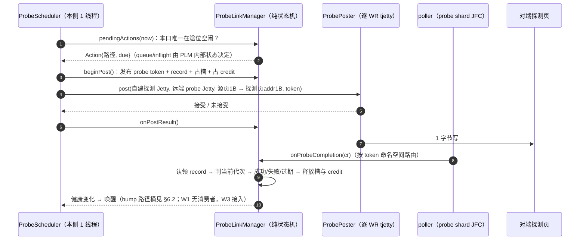
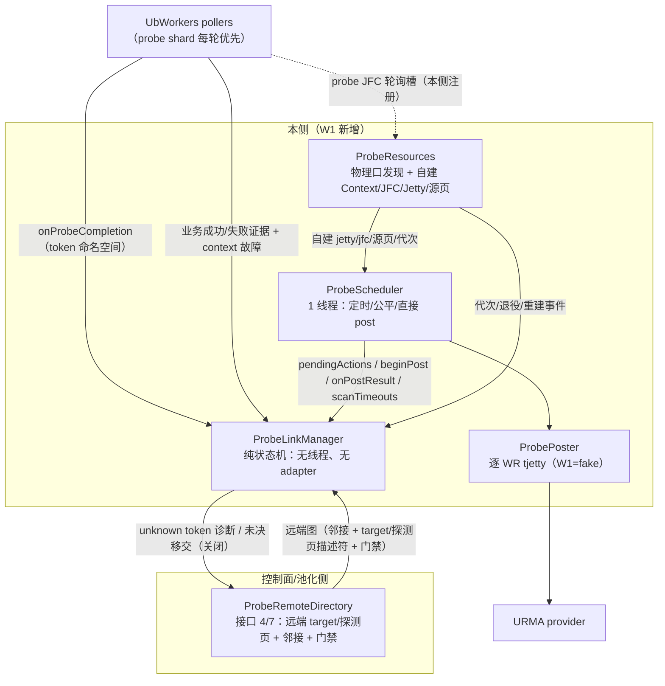

# TENT UB 链路探测（Probe Link）详细设计

> 日期：2026-11-16（v1.7）。v1.1–v1.6 见 §19。**v1.7 架构调整：探测自建 Jetty/Context/JFC/源页，不使用 Jetty 池化；探测固定使用非 bonding 物理口；对外契约收缩为"远端描述符 + 邻接 + 门禁"。** RM 前提保留。
> 代码基线：Mooncake v3 / 956af65e（mooncake-transfer-engine/tent）；本文引用的行号均对应该基线（当前 HEAD 的代码与之一致，其后提交仅改动 docs）。
> 角色关系：**《tent-ub-post-poll-threadpool-design》（修订四，下称"总设计"）为总设计文档**，其 §9 仍是链路探测子系统的总述与接口冻结依据；**本文是 §9 的 W1 详细设计**，细化到可实现、可测试、可评审的程度。冲突时以总设计的接口冻结条款为准，本文需要反向修订总设计的地方集中列在 §17。
> 状态：待实现设计，不表示当前代码已支持。W1 为链路探测先行里程碑（总设计 §13）。
> 范围：只覆盖链路探测子系统——健康状态机、campaign、探测调度、探测 WR、完成/超时/退役、启停、与 poller 的接缝、与池化侧的供给契约（W1 用 stub 冻结）、配置、观测、测试与里程碑。
> 不在本文范围：post/poll 线程池本体（总设计 §4–§8）、**业务 Jetty 的池化与预算**、bootstrap v2 全量协议、TENT/Store/staging 安全接入、池化侧原生资源机械（业务 Jetty 的创建/退役/删除/补池）。**探测 Jetty 由本侧自建自管，不再依赖池化侧资源角色。**
> 阅读建议：第一次接触先看 §1–§2（直觉与资源账），再看 §3–§14（实现规格）；只关心接口的读者看 §12 与 §16。

## 0. 已确认决策与锁定默认

以下 4 项已与负责人确认，本文按此定稿：

| # | 决策 | 结论 |
| --- | --- | --- |
| D-1 | W1 边界 | **薄集成**：独立 PLM/调度器 + poller 三处接缝 + 两个启停钩子；**不改变**现有选路、重试、endpoint 退役行为 |
| D-2 | 探测 WR 远端目标 | **逐 WR tjetty**（RM）；**探测 Jetty 由本侧创建**；远端 target/探测页描述符仍由控制面供给（§12）；per-WR target 的 adapter 能力仍依赖 P0-B |
| D-3 | probe 超时归属 | **PLM 调度线程自管**；总设计 §8 需改写，业务 record 仍在 poller 扫描 |
| D-4 | 探测区粒度 | **每 remote target 一页一槽**（每 peer 每远端口），descriptor 随 target 供给 |

以下 8 项为本文锁定的默认值，评审时若无异议即按此实现：

| # | 默认 |
| --- | --- |
| L-1 | `Pending` 是独立的探测调度标志，**不影响业务选路**；只有 ISOLATED/DISABLED 才进业务过滤 |
| L-2 | campaign 退出条件 = 无 `kQueued/kInflight` 条目；**不等 RECOVERING**（门禁由路径自身的周期重核 + 接口 7 推进） |
| L-3 | 探测失败分两类：路径类（远端路径错误/应答超时）→ 隔离该路径 + 报 lane 退役；lane/配置类（本地设备、flush/suspend、内存/权限、未知）→ 只报 lane 退役 + 同口 Pending，**不记路径 BAD** |
| L-4 | 探测超时 = 责任不明：保留 record 与端口槽、不重发、报 lane 退役、同口 Pending |
| L-5 | token 命名空间 = 高 16 位 kind（0 业务、1 探测）+ 低 48 位序号；`isProbeToken(t) = (t >> 48) == 1` |
| L-6 | 健康表主键 = **完整 PathVersion**（path + topology_epoch + target_epoch）；代次变化即新版本，旧版本不原地改写 |
| L-7 | 业务证据携带 `endpoint_generation`；映射不到时归到该 rail 的**当前 PathVersion** 并计数 `probe_evidence_unmapped`（宁可多隔离一次，靠探测快速收敛，不丢故障） |
| L-8 | 门禁外部门禁（节点/端口/profile）由 provider 在边供给里给布尔位；RECOVERING 路径按 `interval_ms` 继续探测并重估门禁 |

## 1. 心智模型

### 1.1 一句话

业务传输出错后，用一个 1 字节的"试探写"沿同一条路去对端；通了说明这条路好了，没通就继续隔离。平时不探测，出错才探，探通即停。

### 1.2 一次探测的六个步骤



对端**不需要运行任何探测程序**：WRITE 不需要接收方准备，对端只要事先注册一页可写内存，并把"地址 + 长度 + token + 代次"通过握手告诉本端。

### 1.3 什么时候才会探

探测不是"健康路径的常驻心跳"：**HEALTHY 路径不探测**。建连后所有路径是 `ELIGIBLE_UNVERIFIED`（允许业务使用，但没有证据），因此不存在"必须先探通才能发业务"的死循环。触发共四类：

1. **业务失败**：隔离该路径，并对该 peer 发起一次 campaign（全量核验）。
2. **隔离路径的退避重试**：到点探一次，失败则指数退避（1s→2s→…→封顶）。
3. **恢复中的门禁重估**：`RECOVERING` 路径按 `interval_ms` 继续探，并重估门禁。
4. **资源换代后的重新核验**：接口 7 通知新 target/探测页代次。
5. **测试模式（仅前期验证）**：`probe/test/periodic_all=true` 时，按固定间隔对**全部合法链路**发探测，忽略"HEALTHY 不探"与退避；默认关闭，生产禁用。

另外，**合格业务成功是免费证据**：`ELIGIBLE_UNVERIFIED → HEALTHY`，不额外触发探测。

```text
时间线示例（A、B 各 2 口，4 条链路）

t0  建连：4 条链路 "未验证"，业务正常
t1  A0→B0 业务成功          -> A0→B0 = 健康（不探）
t2  A0→B1 业务失败          -> 只隔离 A0→B1；对 peer B 发起 campaign，
                               给 A→B 全部 4 条各派一次核验
t3  调度：A0 先探一条、回来再探下一条；A1 可同时进行（不同口并行）
     3 条探通 -> 保持/变健康；A0→B1 再失败 -> 继续隔离 + 退避（1s→2s→4s…封顶）
t4  退避到点，只探 A0→B1
t5  探通 -> RECOVERING -> 门禁全过 -> HEALTHY，停止该路径探测
```

### 1.4 结果的三种分类

| 结果 | 处理 |
| --- | --- |
| 成功，且属于"当前这一版路径" | `RECOVERING → 门禁 → HEALTHY`，停止探测 |
| 成功，但属于旧代次 | **只结清旧责任**（释放资源），不改健康判断，防"旧成功覆盖新故障" |
| 真实路径错误 | 隔离该路径；**探测通道自退役并重建**（本侧持有，无需上报池化侧） |
| lane/配置类错误 | 自退役重建、同口 Pending，**不把路径记坏** |
| 超时（无完成） | **责任不明**：不重发、不放开该口在途位、自退役，重建后恢复 |

### 1.5 为什么这么设计

| 设计 | 原因 |
| --- | --- |
| 每口只允许 1 个在途探测 | 通道坏时最多留下 1 个"不知道是否执行"的写，不会攒一堆责任不明 |
| 专用 probe Jetty + 专用探测 JFC | 探测不与业务抢发送通道、抢完成队列；业务满负载也不会饿死探测完成 |
| probe token 单独占一段编号 | 完成回来后先看编号段即可判定"这是探测"，不会误入业务结算 |
| 每次探测携带完整身份（ProbeKey） | 路径版本/故障代次/句柄代次对不上就只结清旧账，绝不改动当前健康结论 |
| 隔离 ≠ 端口坏 | 端口级好坏需要完整证据链；探测只负责恢复这一条路的资格 |
| 出错触发而非周期心跳 | 避免"必须先探测才能发业务"的死循环，也避免空闲期无意义流量 |

## 2. 链路、邻接与资源账

### 2.1 链路的定义与计数

一条探测链路 = 一个三元组 **`(本端 local_port, 对端 peer, 对端 remote_port)`**，即一条"合法邻接边"。它**不是**端口数的笛卡尔积，而是配置声明的邻接关系。

```text
A 探测 B 的链路数 = Σ（A 每个本地端口 允许的远端端口数）
```

双端各 4 口的三种典型配法：

| 配法 | A→B 链路数 | 含义 |
| --- | --- | --- |
| 1:1 配对 | 4 | A0 只对 B0，A1 只对 B1，…… |
| 每口 2 邻接（总设计 §9.1 的例子） | 8 | 每个本地口配 2 个远端口，这就是"4 口→8"的来源 |
| 全互联 | 16 | 每个本地口可到全部 4 个远端口 |

```text
每口 2 邻接（8 条）示意：

A0 ── B0
  └── B1
A1 ── B2
  └── B3
A2 ── B0
  └── B2
A3 ── B1
  └── B3
```

### 2.2 三个容易混淆的数

以"4 口、每口 2 邻接、单方向"为例：

| 数 | 值 | 含义 |
| --- | --- | --- |
| 链路数 | 8 | 健康记录条数 = 邻接边数 |
| 探测发送通道 | 4 | 每本地端口一个 probe Jetty；8 条边共用 |
| 对端探测页 | 4 | 对端每端口一页（每 remote target 一槽） |

**8 条链路 ≠ 8 个远端 target ≠ 8 个 probe Jetty**，三者不得混用。

### 2.3 每端资源清单

下表资源**全部由探测子系统自建自管**（§12.1），不来自业务 Jetty 池、不占池化预算：

| 资源 | 4 口/8 条链路时的数量 | 说明 |
| --- | --- | --- |
| ProbeLink（健康记录） | 8 | 一条边一条，键为 PathVersion（§5.4） |
| 探测 Context | 4 | 每物理口一个（adapter `openContext`），与业务 context 分离 |
| probe Jetty | 4 | 每个本地物理口一个，只发探测 WR |
| probe JFC（探测完成队列） | 4 | 每探测 Context 一个、专用；本侧创建 |
| 本端探测源页 | 4 | 每本地口一页、页对齐注册一次，内容不变 |
| 对端探测页 | 4 | 由对端注册并发布 descriptor；本端只消费 |
| import 句柄（本端引用对端探测页） | ≤ 8 | 按 `(ContextKey, target)` 去重；通常等于链路数 |
| 同时在途探测 | 4 | 每端口 1 个（§8.2） |
| `peer_budget`（默认 4） | 不成为瓶颈 | 4 口时最多 4 个在途到同一 peer；端口更多时才生效（§8.2） |

### 2.4 双向独立

A 侧的表记录 A→B 的 8 条，B 侧的表记录 B→A 的 8 条；两侧各自探测、各自判定、互不共享结果。A 探通不代表 B 能探通，反之亦然。

### 2.5 邻接从哪来

**本侧做本端物理口发现**（adapter 枚举 + 过滤 bond，§12.1），**不做 peer 发现**。peer 邻接、远端 target jetty 身份、探测页 descriptor 及其代次，由控制面/池化侧整理后经接口 4（初始化供给）交给本侧，之后通过接口 7 更新（§12.2）。

配置键（`probe/local_ports`、`probe/adjacency`、`probe/target_map`）登记在池化侧配置表（总设计 §12 注 2），两侧共用同一配置源。形状示意（字段名以池化侧配置表为准）：

```jsonc
"transports/ub": {
  "probe": {
    "local_ports": ["A0", "A1", "A2", "A3"],
    "adjacency": {
      "A0": ["B0", "B1"],
      "A1": ["B2", "B3"],
      "A2": ["B0", "B2"],
      "A3": ["B1", "B3"]
    }
  }
}
```

两条约束：

1. **探测图应当是业务可能使用的路径的超集**。业务能走但从不探，等于没有健康保障；探了但业务永远不走，纯属浪费配额。两侧共用同一份邻接配置就是为了保证这点。
2. **全互联不是默认更好**：链路越多，campaign 首轮越长（每口串行）、恢复越慢、页与句柄也越多。

## 3. 设计边界与决策

### 3.1 W1 做什么、不做什么

| W1 做 | W1 不做（后续里程碑） |
| --- | --- |
| ProbeLinkManager：健康状态机、campaign、门禁、结算 | 健康过滤接入业务选路（W3） |
| ProbeScheduler：定时、公平、直接 post、超时、关闭 drain | ~~CompletionRecord / 完成门统一~~（**W2 已完成**：`ProbeRecord.core`） |
| **ProbeResources：本端物理口发现（非 bonding）、自建 Context/JFC/Jetty/源页、自退役重建** | 十类事件分类完整版、marker/AE 上报（W4） |
| poller 三处接缝（槽位、分派、证据喂给）+ 两个启停钩子 | 探测区 descriptor 的 bootstrap v2 正式发布（控制面阶段零） |
| 探测配置键、统计、日志、单测与集成测试 | **RM per-WR target 的 adapter 改造仍依赖 P0-B**（W1 用 fake 承接） |
| **测试模式：定时全量探测（`probe/test/*`，默认关闭）** | — |

### 3.2 与既有机制的关系（W1 只做旁路）

| 既有机制 | W1 的处理 |
| --- | --- |
| RailMonitor 的 pause/错误窗口（[rail_monitor.h](../../mooncake-transfer-engine/tent/include/tent/transport/ub/rail_monitor.h#L76) 的 `RailStats::paused`、[workers.cpp](../../mooncake-transfer-engine/tent/src/transport/ub/workers.cpp#L681) 与 `#L731` 的 `paused` 跳过候选） | **保持原样**，W1 不移除、不改语义；健康状态机只旁路观测 |
| 首次错误即 `endpoint_retirer_` 退役整条 endpoint（[workers.cpp](../../mooncake-transfer-engine/tent/src/transport/ub/workers.cpp#L1010-L1025)；`MEMORY_ERROR`/`UNKNOWN_ERROR` 分支不退役） | **保持原样**；W1 只额外把这次错误喂给健康状态机 |
| 业务超时同步 quiesce（[workers.cpp](../../mooncake-transfer-engine/tent/src/transport/ub/workers.cpp#L1035) `scanTimeouts`） | **保持原样**；probe 超时不走这里（决策 D-3） |
| K / quota / lease | 探测完全不占（不经 post 池） |
| 池化侧"探测 Jetty 资源角色"（旧口径） | **移除**：探测 Jetty 由本侧自建自管，不占业务池、不做租借/预算/tombstone |

> 由此产生的过渡期现象要提前说明：同一故障在 W1 期间可能同时触发"endpoint 退役 + path 隔离 + rail pause"三次惩罚。这是**有意为之的旁路期**，W3 才把选路切换到健康门禁。实机归因时以日志里的 `probe_key`/`path_version` 为准。

### 3.3 线程账

| 线程 | 数量 | 职责 |
| --- | --- | --- |
| ProbeScheduler | 1（首版） | 定时、公平调度、直接 post、超时扫描、关闭 drain 的协调者 |
| poller | 沿用现有（默认 2） | 每轮优先 poll 探测 JFC，完成事件转 PLM |
| post 池 | 沿用现有 | **不参与探测** |

本侧不新增其他常驻线程。

### 3.4 运行前提：RM 传输模式、探测专用非 bonding 物理口

1. **传输模式 = RM（Reliable Message）**。本设计要求"逐 WR 指定远端 target、不做 RC bind"：RM 是消息模式，目标随 WR 走；RC 下 Jetty 必须先绑定一个远端，探测就只能"每条链路一个已绑定 Jetty"，与"每口一个 probe Jetty"冲突。**per-WR target 的 adapter 能力仍依赖 P0-B**；W1 用 `ProbePoster` fake 承接，真实实现按其形状改。RC 不在本设计支持范围。

2. **探测固定使用非 bonding 物理口（已定）**。探测自己完成本端设备发现与资源创建，不依赖池化侧：

   - **发现**：`adapter->discoverDevices()` 枚举 URMA 设备，**过滤掉 bond 设备**（`isBondingDevice`）；可用 `probe/device_filter` 进一步收窄到指定物理口。bond 设备一律不选，不做"自动优先"。
   - **自建资源**：每物理口自建 Context、专用 JFC、probe Jetty、页对齐源页；远端探测页按 target import（§12.1）。不进入业务池、不租借、不占预算、不做 tombstone。
   - **与业务 transport 的关系**：探测的设备集合独立于业务的 `transports/ub/device_filter`，各建各的 Context/Jetty。但**同一台机器不能既启用 bonding 又让探测直连物理口**——bond provider 会接管物理口。若探测启用时发现环境仍是 bonded，**install 失败并提示先关闭 bonding**，不做混用兜底。
   - **对外契约收缩**：接口 4/7 不再供给本地 probe 句柄/JFC/源页，只供**远端描述符 + 邻接 + 门禁**（§12.2）；接口 2 不再接收探测 lane 退役（本侧自退役重建）。

   **TE 的先例（实现形状参考）**：

   - **RM 已是 TE 的默认模式**：`urma_trans_mode = "RM"`，JFR/JFS/import 跟随；`urma_bind_jetty`/`unbind_jetty` 只在 RC 下执行，post 时逐 WR 取 `wr.tjetty`。本设计的 per-WR target 与之一致。
   - **设备集合来自拓扑/配置，不做名字启发式**：TE 只用 `getHcaList()`，没有"发现 bond 就优先"。
   - **一个设备一个 context，失败留占位**：打开失败 `disableDevice()` 但保留索引对齐，全部失败才报错——探测端口索引也按此保持稳定。
   - **bonding 在 TE 里是 opt-in**：`MC_URMA_SET_BONDING_MODE` 才下发；本设计不启用它。

推论：RM 下探测只需要发送 JFC、不需要接收 JFR——§16 #3 的 send-only JFC 是自然形态。

## 4. 模块与文件

### 4.1 分层



### 4.2 文件清单

新增：

| 文件 | 职责 |
| --- | --- |
| `include/tent/transport/ub/probe_types.h` | Key、健康/任务枚举、`ProbeParams`、token 常量、`ProbeStats` |
| `include/tent/transport/ub/probe_resources.h` + `src/transport/ub/probe_resources.cpp` | **本端物理口发现（过滤 bond）**、自建 Context/JFC/Jetty/源页、代次与自退役重建；`ProbeRemoteDirectory`（远端描述符 + 邻接 + 门禁）；`ProbePoster`；两个 sink |
| `include/tent/transport/ub/probe_link_manager.h` + `src/transport/ub/probe_link_manager.cpp` | 状态机、campaign、门禁、结算、健康快照 |
| `include/tent/transport/ub/probe_scheduler.h` + `src/transport/ub/probe_scheduler.cpp` | 线程、deadline 等待、公平调度、post、超时、drain |
| `tests/ub_probe_plm_test.cpp` | 状态机与门禁（虚拟时钟） |
| `tests/ub_probe_campaign_test.cpp` | campaign、代次与 stale |
| `tests/ub_probe_scheduler_test.cpp` | 调度、退避、超时、关闭 |
| `tests/ub_probe_resources_test.cpp` | 物理口过滤/创建失败占位/自退役重建 |
| `tests/ub_probe_integration_test.cpp` | 与 UbWorkers / fake adapter 的接缝 |

改动（都很薄）：

| 文件 | 改动 |
| --- | --- |
| [workers.h](../../mooncake-transfer-engine/tent/include/tent/transport/ub/workers.h) / [workers.cpp](../../mooncake-transfer-engine/tent/src/transport/ub/workers.cpp) | poll 槽位带 role + 两遍轮询；`dispatchCompletion`；业务证据喂给；两个启停钩子 |
| [params.h](../../mooncake-transfer-engine/tent/include/tent/transport/ub/params.h) | §13.1 的配置键与校验（需新增字符串枚举、固定值拒绝、跨键约束三类 helper，**不是纯加法**） |
| [ub_transport.cpp](../../mooncake-transfer-engine/tent/src/transport/ub/ub_transport.cpp) | provider / PLM / scheduler 装配与启停顺序 |
| [tests/CMakeLists.txt](../../mooncake-transfer-engine/tent/tests/CMakeLists.txt) | 4 个测试目标（`USE_UB` 分支内） |

## 5. 数据模型

### 5.1 身份

```cpp
struct ProbePathKey {                 // 物理路径身份（= 现有 UbRailKey 的粒度）
    Topology::NicID local_nic;
    SegmentID       segment_id;       // 对端 peer（目标 segment）
    Topology::NicID remote_nic;
};
struct ProbePeerKey { SegmentID segment_id; std::string peer_nic_path; };

struct PathVersion {                  // 健康表主键（对应总设计的"PathVersion"）
    ProbePathKey path;
    uint64_t     topology_epoch;
    uint64_t     target_epoch;        // 远端 target/探测区代次
};
```

- `ProbePathKey` 与现有 `UbRailKey`（[rail_monitor.h](../../mooncake-transfer-engine/tent/include/tent/transport/ub/rail_monitor.h#L32)）同粒度，但**不参与业务 post 的 `endpoint_generation`**；后者的代次语义分别由 `topology_epoch`/`target_epoch`/`jetty_generation` 承担。
- `PathVersion` 变化（拓扑/target 换代）= 新条目、旧的作废，**不原地改写**（总设计 §9.2）。

```cpp
struct ProbeKey {                     // 单次探测尝试的完整身份
    PathVersion version;              // 这版路径
    uint64_t    fault_epoch;          // 调度时的路径故障代次
    uint64_t    campaign_id;          // 0 = 周期探测
    uint64_t    campaign_epoch;       // campaign 合并代次
    uint64_t    probe_seq;            // 每路径单调
    uint64_t    jetty_generation;     // 本地 probe Jetty 代次
    uint64_t    area_epoch;           // 远端探测页代次
};
```

健康判据 = `PathVersion` + `fault_epoch` + `jetty_generation` + `area_epoch`（不含 `probe_seq`，也不含 `campaign_id/epoch`）；`probe_seq` 只用于**任务槽归属与在途唯一性断言**，`campaign_id/epoch` 只用于 **campaign 记账过滤**。任一健康字段对不上的结果只结清旧责任（§9.2）。

### 5.2 运行态

```cpp
enum class LinkHealth : uint8_t { kEligibleUnverified, kHealthy, kIsolated, kRecovering, kDisabled };
enum class TaskState  : uint8_t { kIdle, kQueued, kInflight };      // 每路径一个任务槽
enum class EntryState : uint8_t { kQueued, kInflight, kOk, kFail, kCanceled };

struct PathRuntime {                   // 键：PathVersion
    LinkHealth health{kEligibleUnverified};
    uint64_t   fault_epoch{0};
    uint64_t   consecutive_failures{0};
    uint64_t   success_count{0};
    uint64_t   probe_seq{0};           // 每路径单调（日志关联 + 在途唯一性断言）
    uint64_t   inflight_seq{0};        // 当前在途探测的 probe_seq；0 = 无在途
    uint64_t   backoff_ns{0};
    uint64_t   next_probe_ns{0};
    TaskState  task{kIdle};            // kQueued 仅表示"有 campaign 条目待发"，不含快照
    bool       pending{false};         // L-1：只影响探测可调度性
    PendingReason pending_reason{};
    uint64_t   pending_since_ns{0};
};

enum class RecordState  : uint8_t { kPosting, kAwaiting, kRejected, kSettled, kOrphan, kHandedOff };
enum class OrphanReason : uint8_t { kNone, kTimeout, kChannelRetired, kShutdown };

struct ProbeRecord {                   // W2 已落地：core 即共享 CompletionRecord（§5.5）
    CompletionRecord core;             // token / 身份 / 一次性事实位：
                                       //   settled → core.finalize_claimed
                                       //   timed_out / token → core.timed_out / core.token
    ProbeKey        key;               // 完整探测身份（fault_epoch/campaign/probe_seq）
    ProbePeerKey    peer;              // 预算释放用（PathVersion 行被删后仍需）
    uint64_t        posted_ns{0};
    uint64_t        deadline_ns{0};
    RecordState     state{kPosting};
    OrphanReason    orphan_reason{kNone};
    LocalSegmentPtr source;            // 持引用 ⇒ 源页不会在 record 前注销
    RemoteSegmentPtr area;
    uint32_t        credit{1};
};

struct PortRuntime {
    ProbePortResources resources;      // 本侧自建：Context/JFC/Jetty/源页（§12.1）
    uint64_t generation{0};            // 本侧递增的探测通道代次
    // 槽只对"当前 generation"有意义：退役时保持占用（不重发），
    // 本侧重建出新代次时归零；旧在途记录转入孤儿表（§9.5）。
    uint64_t slot_token{0};            // 当前代次唯一在途 probe 的 token
    uint64_t slot_generation{0};       // 槽所属 probe Jetty 代次；releaseSlot 必须比对
    bool     handle_valid{true};       // 退役即置 false；旧句柄证据不得发布健康
    uint64_t broken_since_ns{0};       // 退役后暂停，等本侧重建完成
    size_t   rr_cursor{0};
    uint32_t inflight{0};              // 当前代次在途数（孤儿不计）
};

struct CampaignEntry { EntryState state{kQueued}; uint64_t entry_epoch{1}; };
struct Campaign {
    uint64_t id, epoch{1};
    ProbePeerKey peer;
    std::unordered_map<PathVersion, CampaignEntry> entries;
};
```

### 5.3 token 命名空间（L-5）

```cpp
constexpr uint64_t kTokenKindShift    = 48;
constexpr uint64_t kTokenKindBusiness = 0;
constexpr uint64_t kTokenKindProbe    = 1;
constexpr uint64_t kTokenSeqMask      = (1ULL << kTokenKindShift) - 1;

inline uint64_t makeProbeToken(uint64_t seq) { return (kTokenKindProbe << kTokenKindShift) | (seq & kTokenSeqMask); }
inline bool     isProbeToken(uint64_t t)     { return (t >> kTokenKindShift) == kTokenKindProbe; }
```

- `token == 0` 仍保留给 marker（不参与探测）。
- 业务 token 继续用现有单调计数（[workers.cpp](../../mooncake-transfer-engine/tent/src/transport/ub/workers.cpp#L1162) 的 `nextCompletionToken`），实际不可能触及 2^48，无需改动。
- poll 线程的判定顺序：**先 namespace，再看 status/flag**（为 W4 的 flag/status 陷阱留好位置，见 §11.2）。

### 5.4 主键与生命周期

| 事件 | 处理 |
| --- | --- |
| 初始化（接口 4） | 本侧发现物理口并自建资源（§12.1）；接口 4 只给远端图（邻接 + target/探测页描述符 + 门禁）；每条边建 `PathVersion` 条目，全部 `kEligibleUnverified` |
| 图更新（接口 7）新增边 | 新条目 `kEligibleUnverified` |
| 图更新换代（topology/target 变化） | 旧 `PathVersion` 立即从表中删除；在途 record 自带 key，结算时判为 stale；campaign 中该版本的条目置 `kCanceled`（否则 campaign 等不到终态） |
| 图更新撤边 | 同换代，删除条目；在途 record 只结清 |
| context 故障（接口 9） | 该本地口所有路径 `kDisabled`；记录保留到在途终结，之后等待新图的路径条目 |
| 探测通道退役 | `laneRetire` 只置该口 `pending=true`（L-1）、`handle_valid=false`；未决 record 由 `moveToOrphans` 转移（§9.5），随后**本侧自建新代次**并恢复 |
| 本侧重建完成 | 清 `broken/pending`、`slot_token=0`、`slot_generation=新代次`、`inflight=0`；旧代在途先转孤儿（§9.5） |

## 6. 健康状态机

### 6.1 状态

| 状态 | 业务可用 | 含义 |
| --- | --- | --- |
| `ELIGIBLE_UNVERIFIED` | 是 | 还没证据，但允许受控尝试（避免启动死循环） |
| `HEALTHY` | 是 | 当前代次证据与门禁都通过；**不代表有空闲业务 Jetty** |
| `ISOLATED` | 否 | 已确认坏，周期+退避探测中 |
| `RECOVERING` | 否 | 探通了，但外部门禁未全过 |
| `DISABLED` | 否 | context drain/故障或拓扑撤销；**不通过探测恢复**，等新图版本 |

### 6.2 迁移与副作用

| 迁移 | 触发 | fault_epoch | 任务/定时 | 通知 |
| --- | --- | --- | --- | --- |
| ELIGIBLE → HEALTHY | 合格业务成功；或当前代次探测成功 | — | 停任务 | 无需 bump（资格未变） |
| ELIGIBLE/HEALTHY/RECOVERING → ISOLATED | **业务错误**（非参数/长度/权限类） | **++** | `next=now`，立即排一次 | bump 路径桶 |
| ISOLATED → ISOLATED | **业务错误（已在隔离中）** | —（幂等，不 ++） | 不变 | — |
| ELIGIBLE/HEALTHY → ISOLATED | campaign 核验**探测失败（路径类）** | **++** | 退避 | bump 路径桶 |
| ISOLATED → ISOLATED | 探测失败（已在故障中） | —（不新增代次） | 退避加倍封顶 | — |
| ISOLATED → RECOVERING | 当前代次探测成功，门禁未全过 | — | 保留周期重探 | — |
| RECOVERING → HEALTHY | 门禁全过（同一同步点） | — | 停任务、停定时 | bump 路径桶 |
| RECOVERING → ISOLATED | 新故障（业务或探测） | **++** | 退避 | bump 路径桶 |
| 任意 → DISABLED | context 故障 / 图撤销 | — | 取消任务，record 保留到终结 | bump（业务侧本就排除） |
| HEALTHY 上探测成功 | — | — | 无操作 | — |
| ISOLATED/RECOVERING 上业务成功 | — | — | **无操作**（旧成功不解封新故障） | — |

### 6.3 三条容易写错的规则

1. **业务成功只能把 `ELIGIBLE_UNVERIFIED` 提升为 `HEALTHY`**，不能解除 `ISOLATED`/`RECOVERING`。否则一条早于故障、迟到的成功完成会抵消刚发生的故障。
2. **探测失败是否 `fault_epoch++` 取决于当前健康状态**：`ISOLATED` 上失败只是"还没好"（不动代次），其余状态上失败才是"新发现的坏"（代次++）。这条直接决定门禁能否被旧证据误通过。
3. **业务错误是幂等的**：只有当前状态不是 `ISOLATED` 时才 `fault_epoch++` 并建/合并 campaign；已隔离时再报错只计数（`business_error_while_isolated`）。否则 W1 未接入选路时，业务会持续打到已隔离路径、持续抬代次，在途探测永远 stale，路径永远到不了 `RECOVERING`。

## 7. campaign

### 7.1 定义

campaign = **一次针对某个 peer 的受限全量核验**。同 peer 同时最多一个；给快照内每条合法路径派一次核验任务（每路径一项、去重合并、队列有界）。

### 7.2 业务错误处理

```text
onBusinessPathError(ev{path, endpoint_generation, kind}):
  if ev.kind ∈ {本地参数, 长度, 权限}:
      只计数并限速告警，返回                       # 总设计 §7.4 末条
  lock:
      ver = resolveVersion(ev)                      # generation -> PathVersion（L-7）
      rt  = paths[ver]
      if rt.health == kIsolated:                    # 幂等：隔离中的重复报错不抬代次
          business_error_while_isolated++; unlock; return
      rt.fault_epoch++
      rt.health = kIsolated
      rt.backoff_ns = 0; rt.next_probe_ns = now; rt.consecutive_failures = 0
      c = campaigns[ver.peer]
      if c && active:
          c.epoch++                                 # 合并：除"在途 campaign 项"外全量重排队
          for each cur in graph.pathsOf(ver.peer):
              e = entryOf(c, cur)
              if e && e.state == kInflight: continue # 在途核验：按旧 epoch 结算，整条跳过
              upsert(c, cur, c.epoch)               # 建/重置条目为 kQueued（含周期在途者）
              cur.next_probe_ns = now
              if cur.task != kInflight: cur.task = kQueued   # 周期在途者等结算后接上
      else:
          c = create(campaign_id = ++seq, epoch = 1, peer = ver.peer)
          for each cur in graph.pathsOf(ver.peer):
              e = entryOf(c, cur)
              if e && e.state == kInflight: continue
              upsert(c, cur, 1)
              cur.next_probe_ns = now
              if cur.task != kInflight: cur.task = kQueued
  unlock
  emit(bucketBump(path)); scheduler.wake()
```

### 7.3 合并语义（L-2 与代次线性化）

- 合并 = `c.epoch++` + 给该 peer **除"在途 campaign 核验项"外**的全部路径重新 upsert 到新 epoch（建/重置为 `kQueued`，`next_probe = now`）。若该路径正被**周期探测**占着（`task==kInflight` 但没有在途 campaign 项），只建/刷新条目、不动 `task`，结算后由 `releaseTaskSlot` 接上。
- **条目收敛**：`campaignProgress(key, outcome)` 在每次结算末尾调用；仅当 `key.campaign_id != 0 && c.id == key.campaign_id && entry.state == kInflight && entry_epoch == key.campaign_epoch` 时置终态。**周期项固定取 `(campaign_id=0, campaign_epoch=0)`**，永不命中 campaign 条目；条目不存在/已终态则忽略。
- **发起即对齐**：`beginPost` 持锁把条目置 `kInflight` 并把 `entry_epoch` 刷成当前 `c.epoch`，ProbeKey 直接取该值；周期项不做条目对齐（id/epoch 恒为 0）。因此**不需要额外的"post 前快照复核"字段**。路径版本已消失 → 条目置 `kCanceled`、`task = kIdle`。
- **在途 record 不取消**：结果回来时 `fault_epoch`/版本/句柄代次对不上才判 stale（只结清资源、不推进健康）；`campaign_epoch` 对不上不影响健康判定，只让 campaign 记账忽略该结果（本页首条）。
- 收敛退出：所有条目进入 `kOk/kFail/kCanceled` 且无 `kInflight` → 退出（等待 `kQueued` 为 0）。**campaign 可因资源不可用挂起**：lane 退役后 `broken`/`pending` 会让 `kQueued` 条目发不出去，campaign 就停在那里等接口 7 重建——这是设计内行为，不是"卡死"；用 `campaign_waiting_for_event` + `pending_since_ns` 观测，长时间不恢复由失败告警/上层处置。**不等待 `RECOVERING`**：门禁未过的路径由它自己的周期重探 + 接口 7 推进，否则门禁长期不满足时 campaign 永远不退出。
- 新业务错误在 campaign 退出后到达 → 新 campaign（`campaign_id` 递增），不会复活旧条目。

### 7.4 公平性

campaign 条目的"优先"只等价于 **`next_probe_ns = now`（due 立即）**，端口内仍走 round-robin 游标，不跳队。否则同口其他 peer 的周期探测会被 campaign 长期饿死。

## 8. 探测执行与调度

### 8.1 调度循环

```text
loop:
  now = clock()
  for action in plm.pendingActions(now):        # 每口至多 1 项
      rec = plm.beginPost(action, makeProbeToken(++probe_token_seq))
      res = poster.post(rec, action)            # 锁外
      plm.onPostResult(rec, res)
  plm.scanTimeouts(clock())
  cv.wait_until(min(plm.nextDeadline(), stopping))
```

`pendingActions` 只是**计算**（持锁读状态），真正 post 与结果处理都在锁外；`beginPost` 持锁完成"发布 token + 建 record + 置 `task=kInflight`/`inflight_seq=probe_seq` + 占端口槽（`slot_token`/`slot_generation`）+ 占 credit"。这样满足"token 先于 native post 发布"，也保证 CQE 早于 post 返回时一定能查到 record。

候选条件（每口至多返回 1 个）：公共条件 `!port.broken && port.slot_token == 0 && !path.pending && peer_inflight[peer] < peer_budget`，且满足任一：

- **campaign 项**：`task == kQueued` 且该 peer 的 campaign 条目仍为 `kQueued`；
- **周期项**：`task == kIdle && health ∈ {ISOLATED, RECOVERING}` 且 `now >= next_probe_ns`；
- **测试项**（仅 `probe/test/periodic_all`）：`task == kIdle && now >= test_due_ns`，**不受 health 与退避限制**（含 HEALTHY）。

优先级：campaign > 周期 > 测试；口内按 `rr_cursor` 轮转。**`ELIGIBLE_UNVERIFIED`/`HEALTHY` 在非测试模式下不做周期探测**，只作为 campaign 项被核验。`beginPost` 负责把条目标 `kInflight` 并对齐 epoch（§7.3），调度侧不再维护快照。

### 8.2 单口单在途、peer_budget、credit

- **每端口最多 1 个在途探测**（含责任不明阶段）：`slot_token != 0` 时该口不 post。原因：探测只应留下一个"责任不明"的写，避免通道故障时连带多个在途探测。
- **槽按 generation 作用域**：`slot_token` 只描述"当前这一代探测通道"的在途；退役后该槽保持占用（不重发），但**本侧重建出新代次时归零**，旧在途转为孤儿 record（§9.5）。否则一次超时会让该口永久停摆。
- **`peer_budget`（默认 4）**：同 peer 跨口在途上限，计数为 `peer_inflight[peer]`（`beginPost` 递增，结算/回滚递减）。**超时转孤儿时随记录释放其预算**（孤儿不计入），否则同一 peer 累计 4 次超时就会让整个 peer 不可调度。不满足时跳过该 peer 的候选，不改 `next_probe_ns`；有 slot 释放时重算。
- **`credit`**：每口控制额度；单在途下需求恒为 1，保留计数为后续扩展。探测 JFC 专用，不再有 shared 模式。

### 8.3 退避

```text
delay = min(interval_ms << min(failures - 1, 16), backoff_max_ms)
```

失败时 `failures++` 并设 `next_probe_ns = now + delay`；成功清零。**不加随机抖动**（可测试性优先，口间本就串行）。

退避与通道重建的关系要写死：路径类失败会退役该口的探测通道（§9.5），而本侧重建可能很快完成——**重建完成不覆盖 `next_probe_ns`**。否则会形成"失败 → 退役 → 立刻重建 → 立刻重探 → 再失败"的重建风暴；有退避时，持续坏的路径最多每 `backoff_ms` 触发一次重建。

### 8.4 探测 WR 构造

| 字段 | 值 | 依据/说明 |
| --- | --- | --- |
| opcode | `URMA_OPC_WRITE` | 只写不读，无需对端准备接收 |
| complete_enable | `1` | 需要完成事件 |
| next | `nullptr` | 恰好一条 WR |
| src sge | 本端探测源页，`len = 1` | 源页按页对齐注册（payload=1 ≠ 注册长度 1） |
| dst sge | 探测区 `address`，`len = 1` | 地址来自 descriptor，不猜 |
| `user_ctx`/token | probe token（非 0，kind=1） | 完成时按命名空间路由 |
| `tjetty` | 该链路的远端 probe Jetty | **逐 WR 指定，不依赖本地 bind**（决策 D-2） |
| 本地 bind | 不做 | 探测 Jetty 不参与 RC bind |

`ProbeWorkRequest` 是探测专用结构，**不复用现有 `WorkRequest`**（后者没有 tjetty 字段，现 adapter 取绑定远端）。职责切分：`ProbePostTarget` 持有句柄（本地/远端 Jetty、探测页 segment），`ProbeWorkRequest` 只放 WR 载荷（`opcode=WRITE, token, source_address/length=1, area_address/length=1`），见 §12.2。P0-B 落地后由 adapter 映射到 `urma_jfs_wr_t`（`wr.tjetty` 逐 WR 指定）。

UMDK 参考（`bondp_dp_health.c`，本地 `.tmp-umdk/`）：`HC_PROBE_BUF_LEN=1`、`HC_PROBE_SEG_LEN=getpagesize()`，注释明确"payload 只有 1 字节，但注册段必须覆盖整页"。本设计照此，但**不复用其"重建即责任终结"的假设**：我们要求完成或 flush 证据（§9.4/§9.6）。

约束：不写业务内存、不复用业务数据 segment 的授权、不校验所谓 magic 字节；探测页由对端独立注册、独立 token。

### 8.5 探测区 descriptor

每个 remote target 一个页对齐槽（决策 D-4），至少包含：

```text
area = { address, length, token, epoch }
```

- 由对端注册、由池化侧经接口 4 供给；本侧只消费，不推导地址。
- 多口并发写同一页同一字节是**安全**的：payload 是常量、无读回语义。这也是"每 target 一槽"足够、不必每路径一槽的原因。
- 换代（`area_epoch` 变化）→ 原地更新该边（不换主键）；在途 record 判 stale，周期项 `next_probe_ns = now`，**campaign 条目保留**（用新探测页继续核验）。

### 8.6 post 结果处理

| 结果 | 判定 | 处理 |
| --- | --- | --- |
| 未接受 | `posted_count == 0 && !ok` **且 `!rec.settled`** | 释放槽与 credit、删 record、调用 **`releaseTaskSlot(rec)`**（条目 `kInflight` → 回退 `kQueued`；`kQueued` → 保持；已终态/缺失 → `kIdle`）；`next_probe_ns = now + min(interval, 100ms)`；计 `probe_post_rejected`（**不是**路径故障） |
| 未接受 × 已完成（冲突） | 同上但 `rec.settled == true` | **不回滚健康、不重复释放**；计 `probe_post_conflict`；按总设计 §1.2.4「确定零接受与真实 CQE 冲突 → 隔离该资源」退役该口探测 lane |
| 已接受 | `posted_count == 1` | 保留 record，等 CQE 或超时 |
| 未定 | 返回错误但无法证明未接受 | 按已接受处理（不重发、等 CQE/超时），计 `probe_post_unknown` |

连续 `probe_post_rejected` 超过 `failure_threshold` → 只限速告警；不隔离路径、不重试风暴。

### 8.7 时间结构

路径数上界 = Σdegree（4 口→8，6 口→12），**线性扫描 + 条件变量即可**，不需要 timer wheel：

- `nextDeadline() = min(所有可调度 next_probe_ns, 所有 test_due_ns, 所有在途 deadline_ns)`
- 唤醒源：完成结算、接口 7、post 结果、stop。
- 因此不引入堆/时间轮，减少一类难以测试的 bug。

### 8.8 测试模式：定时全量探测

前期验证用，复用同一调度器，不新开线程。

| 键 | 默认 | 语义 |
| --- | --- | --- |
| `probe/test/periodic_all` | `false` | 开启后对全部合法链路定时探测 |
| `probe/test/interval_ms` | `5000` | 每路径的测试间隔 |
| `probe/test/apply_health` | `true` | 结果是否驱动健康状态机 |

行为：

- 每个路径维护 `test_due_ns`；到点后作为"测试项"参与调度（§8.1），仍受**每口单在途 + peer_budget + 口内轮转**约束；campaign 优先。
- **不受 HEALTHY 不探与退避限制**：即使路径已 HEALTHY 或刚失败，仍按 `interval_ms` 继续探。
- `apply_health=true`：结果正常驱动 `ISOLATED/RECOVERING/HEALTHY`，但**失败不走指数退避**（下一轮仍按测试间隔）；
- `apply_health=false`：只计 `probe_test_*`、打日志，**不改健康**（纯链路检查，适合第一次接通）。
- 启动时打印 warning："probe test mode enabled: periodic probing of all links"；`interval_ms < timeout_ms` 时额外告警（单在途保证不重叠，但会让该口长期被占）。
- **生产禁用**：这个开关会产生持续探测流量，只用于前期验证/联调。

记录处理：测试探测的 `ProbeKey.campaign_id = 0`；`apply_health=false` 时结算路径跳过 `apply()/campaignProgress`，只做资源结清与 `test_due_ns = now + interval`。

## 9. 完成、超时与退役

### 9.1 完成分派（poller 线程）

```text
dispatchCompletion(c):                 # UbWorkers 内
  if isProbeToken(c.token): probe.onProbeCompletion(c); return true
  if c.token != 0:          handleCompletion(c)
  else:                     保持现状（W4 起走接口 8）
```

**必须替换全部三处完成消费点**，不能只改 poller 主循环：`workers.cpp:401`（主循环）、`:222`（`stop()` 里 `endpoint->quiesce` 回吐）、`:1061`（`scanTimeouts` 回吐）。后两处在 shared JFC 模式下可能返回探测完成（探测 Jetty 与业务共用 JFC 时，`quiesce` 轮询同一 JFC），若仍走 `handleCompletion` 会因业务 `inflight_` 查不到而静默丢弃。

`onProbeCompletion` 在 poll 线程里只做 O(1) 的"查表 → 认领 → 结算健康 → 放槽"，不调用池化侧、不等锁外的长操作；所有 sink 在解锁后调用（§14.1-6）。

顺带一条给 P0-B 的注释：shared JFC 模式下 `quiesceJetty` 会对**整个发送 CQ** 的 CR 逐条 `releaseSegment(token)`（[urma_adapter.cpp](../../mooncake-transfer-engine/tent/src/transport/ub/urma_adapter.cpp#L1488-L1502)），对未知 token 是 no-op（`inflight_segments_.erase`），所以探测 WR 即使被业务 quiesce 回吐也不会破坏业务记账；但**不要把探测 WR 注册进业务的 `inflight_segments_`**。

### 9.2 结算算法

```text
onProbeCompletion(cr) -> bool:
  if !isProbeToken(cr.token): return false
  lock:
    rec = lookup(cr.token)                         # 先 inflight，再孤儿表
    if !rec: unknown_probe_token++; unlock; emitUnknownToken(); return true
    if rec.state == kOrphan:                       # 迟到完成：只结清，不造证据
        refs = settleOrphan(rec)                   # 摘表 + settled CAS；不改健康
        unlock; releaseRefs(refs); return true
    if rec.settled.exchange(true): unlock; return true      # 一次性认领
    inflight.erase(rec); rec.state = kSettled
    releaseSlot(port, rec)                         # token+generation 双校验；不等只记 anomaly
    releaseBudget(peer, rec)
    cur  = paths[rec.key.version]
    edge = edges[rec.key.version]
    current = cur && edge && port.handle_valid
           && cur.fault_epoch == rec.key.fault_epoch
           && rec.key.jetty_generation == port.generation
           && rec.key.area_epoch == edge.area_epoch
           && cur.health != kDisabled
    if current: apply(cr, cur, edge)
    campaignProgress(rec.key, current ? mapOutcome(cr) : kCanceled)
    releaseTaskSlot(rec)      # 按条目最终状态决定 kQueued/kIdle，并清 inflight_seq
  unlock
  releaseRefs({rec.source, rec.area, rec.credit})  # 句柄析构会调 adapter，必须锁外
  锁内收集副作用（laneRetire/健康变化/campaign 进度），锁外统一发送；未发生的副作用不发
```

```text
apply(cr, cur, edge):
  switch classify(cr):
    SUCCESS:
      cur.consecutive_failures = 0; cur.backoff_ns = 0
      switch cur.health:
        kHealthy:             no-op                       # 常态核验，不重复 bump
        kEligibleUnverified:  gate(...) ? publishHealthy(cur) : stay()
        kIsolated:            cur.health = kRecovering
                              gate(...) ? publishHealthy(cur) : stay()
        kRecovering:          gate(...) ? publishHealthy(cur) : stay()
    PATH_ERROR:
      if cur.health != kIsolated: cur.fault_epoch++
      cur.health = kIsolated
      cur.consecutive_failures++
      cur.backoff_ns = min(interval << min(consecutive_failures-1, 16), backoff_max)
      cur.next_probe_ns = now + cur.backoff_ns             # 不立即重发
      laneRetire(port)                                     # 该口暂停 + 同口 Pending
    LANE_ERROR:
      laneRetire(port); markPortPending(port)              # 不记路径 BAD
    default:
      laneRetire(port); markPortPending(port)
```

`mapOutcome(cr)`：`SUCCESS→kOk`、`PATH_ERROR→kFail`、其余（含 LANE_ERROR/UNKNOWN）→`kCanceled`。

`settleOrphan(rec)`：锁内从孤儿表摘除并 `settled` CAS（一次性），返回需释放的引用；**不改健康、不推进 campaign**，`peer_inflight` 已在转孤儿时释放。

`releaseRefs(...)`：锁外释放 `source`/`area`/`credit`——`RealLocalSegment`/`RealRemoteSegment` 的析构会调 adapter 的 `close()`，不能持 PLM 锁执行。

`releaseSlot(port, rec)`：仅当 `port.slot_token == rec.token && port.slot_generation == rec.key.jetty_generation` 时清槽并 `inflight--`；否则只记 `probe_slot_anomaly`（旧代迟到完成不得动新代的槽）。

> **W2 落地后的命名**：本节伪码沿用 W1 的 `rec.settled` / `rec.timed_out` / `rec.token`；实现上它们是 `rec.core.finalize_claimed` / `rec.core.timed_out` / `rec.core.token`（共享内核，语义与一次性保证不变）。伪码保留 W1 命名以对应本节的结算语境。

`releaseTaskSlot(rec)`：**先按 `probe_seq` 短路**——`cur` 为空或 `cur.inflight_seq != rec.key.probe_seq` 直接 return（非归属者整个函数不动）。否则清 `inflight_seq`，按该 peer campaign 里该版本条目的最终状态决定：

- 条目存在且 `state == kInflight` → **回退为 `kQueued`**、`task = kQueued`（post 未接受/epoch 失配的兜底；超时与换代的 `moveToOrphans` 已先 `campaignProgress(kCanceled)` 终态化，不会走到这里）；
- 条目存在且 `state == kQueued` → `task = kQueued`（epoch 由 `beginPost` 对齐）；
- 否则 → `task = kIdle`。

**这是所有结算路径的唯一任务槽出口**：§9.2 完成、§9.4 超时、§9.5 换代、§8.6 post 未接受都调它。

### 9.3 错误分类表（W1 临时映射）

| adapter `CompletionCategory` | 归类 | 处理 |
| --- | --- | --- |
| `SUCCESS` | 成功 | 恢复推进 |
| `REMOTE_PATH_ERROR`、`TIMEOUT` | **路径类** | 隔离路径 + lane 退役 |
| `LOCAL_DEVICE_ERROR` | lane 类 | lane 退役 + 同口 Pending + context 不可用通知 |
| `ENDPOINT_ERROR`（含 flush/suspend/unhandled） | lane 类 | lane 退役 + 同口 Pending |
| `MEMORY_ERROR` | lane/配置类 | lane 退役 + `probe_area_config_error` 告警，不误伤路径 |
| `UNKNOWN_ERROR` | lane 类 | lane 退役 + 告警 |

> 该映射建立在当前 adapter 的 `classifyCompletion` 之上；W4 引入 typed marker/flag 后，本表仅在"探测"语境下保留，且必须仍满足"namespace 先行"。
>
> 命名冲突提醒：本表的 `TIMEOUT` 指 provider 返回的 `URMA_CR_ACK_TIMEOUT_ERR`（**有**完成事件），与 §9.4 的"完成超时（**无**完成）"不是一回事。ACK 超时也可能源于本地设备，本设计按路径类处理并同时退役 lane，两种成因都能被覆盖（路径由探测复核、lane 由池化侧重建），另计 `probe_ack_timeout` 便于区分。

### 9.4 完成超时（无完成，责任不明）

```text
scanTimeouts(now):
  for rec where deadline_ns <= now && !rec.timed_out.load() && !rec.settled.load():
      if rec.timed_out.exchange(true):                 # 一次性：同一 record 只处理一次
          probe_timeout_unknown++
          laneRetire(port)                             # 本侧退役探测通道（无需上报）
          markPortPending(port)                        # 同口其余路径 Pending，不记 BAD
          moveToOrphans(rec, kTimeout)                 # 统一转移：campaignProgress(kCanceled) + 清任务槽 + 放预算 + 入孤儿表
```

- 超时**不结清资源**、不解除源页 pin、不放当前代次的端口槽（L-4）；`timed_out` 与 `settled` 是两个独立的一次性位。
- **迟到的完成**（真实 CQE 或 flush 证据）命中 `kOrphan`：只结清资源/引用/credit，不改健康、不发布证据（对齐总设计 §8"迟到 CQE 只终结硬件责任，不二次结算逻辑结果"）。
- W1 内超时记录只有三种终结路径：迟到自然完成、本侧 flush 证据（自建 Jetty 的 quiesce）、关闭时移交。**端口恢复不依赖它终结**——本侧重建完成即恢复（§9.5）。
- "端口槽保留"与"campaign 条目取消"是两件事：槽保留是为了不重发、不重叠；条目取消是为了不让一个永远没有完成的 record 把 campaign 卡在 `kInflight` 上（路径本身既不记 BAD，也不被这条超时推进）。

### 9.5 通道退役、自重建与 Pending

`laneRetire(port, reason)` 做三件事：

1. 置 `port.handle_valid = false`、`port.broken_since_ns = now`（该口不再 post；旧句柄的迟到证据一律判 stale）；
2. 该口所有路径 `pending = true`，`pending_reason = channel_retired`；
3. 对旧代在途记录 `moveToOrphans(rec, kChannelRetired)`，并**触发本侧重建**（ProbeResources 异步执行）。

**重建由本侧完成**（不向池化侧上报、不依赖接口 2/7）：

```text
ProbeResources::rebuild(port):
  1. quiesce/delete 旧 probe Jetty（必要时 flush 旧 WR）
  2. 新建 Jetty + 新源页（页对齐注册）+ generation++
  3. 清 broken/pending、slot_token=0、slot_generation=新代次、inflight=0、
     置 handle_valid=true，保留 rr_cursor
  4. 按原健康状态继续（ISOLATED 立即探、其余不动）
```

- 旧代孤儿仍在孤儿表（按 token 索引），其 `source`/`area` 引用继续持有；不计 `peer_inflight`。
- **源页按 generation 隔离**：每代独立源页，孤儿持有的旧页在其终结/移交前不得注销。这样新代次可立即探测，而旧的可能仍在 DMA 的 WR 不会与新 WR 共享源内存。
- 重建完成**不覆盖** `next_probe_ns`（§8.3），避免"失败→重建→立刻重探"的风暴。

记录转移是独立动作 `moveToOrphans(rec, reason)`，三个入口共用：**完成超时（kTimeout）、通道退役（kChannelRetired）、关闭到期（kShutdown）**。它做五件事（顺序固定）：`campaignProgress(key, kCanceled)` → `releaseTaskSlot(rec)` → 释放 `peer_inflight` → 置 `state=kOrphan`/`orphan_reason` → 移入孤儿表。**保留 `source`/`area` 引用**，供迟到完成或移交使用。

### 9.6 关闭与未决责任

`drainBeforePollStop(deadline)`：

```text
1. stopPosting 并 join 调度线程（此后不再 scanTimeout）
2. drain_deadline = now + timeout_ms；循环等 inflight 清空或到点（poller 仍在跑，完成正常结算）
3. 到点仍在 inflight 的 record：moveToOrphans(..., kShutdown)
4. 孤儿表与这些记录**继续保留其 source/area/context/jetty**（不释放、不注销）
5. 返回 {settled, unproven}，随 shutdown 结果上报（Draining/Unproven）
```

- **deadline 由 drain 的调用线程判**（`workers.stop`），不依赖已 join 的 `scanTimeouts`；到点即转孤儿，不因"等 flush"而无限期阻塞。
- **不再有跨侧移交**：探测资源本来就在本侧，`handoffUnproven`/`ProbeHandoff` 全部删除。未决记录的资源**故意保留**（进程退出由 OS 回收），避免在未知 DMA 上释放/注销。
- 并发到达的完成：命中 `kOrphan` 只结清资源，不造证据；移交后查不到则计入 unknown token 诊断，不会双释放。
- 三个入口（超时/通道退役/关闭）都经 `moveToOrphans`，其内置 `campaignProgress(kCanceled)`，所以关闭到期不需要额外记账。

## 10. 恢复门禁

### 10.1 门禁项

一次**当前代次**探测成功，还要同时满足：

| # | 条件 | 数据来源 |
| --- | --- | --- |
| 1 | ProbeKey 属于当前 `PathVersion`（topology/target 匹配） | PLM |
| 2 | 提交时 `fault_epoch` == 当前 `fault_epoch`（中间无更晚业务故障） | PLM |
| 3 | 本侧 probe Jetty 代次 == record 记录代次 | 本侧 ProbeResources |
| 4 | 探测页 `area_epoch` 未变、未被撤销 | 远端描述符（接口 4/7） |
| 5 | 本侧探测 Context 有效、远端 target 未撤销 | 本侧 / 远端描述符 |
| 6 | 节点/端口门禁允许、业务能力 profile 有效 | provider（边供给里的布尔位） |

```text
gate(rec, cur):
  v = rec.key.version
  evidence_current = port.generation == rec.key.jetty_generation
                  && edge[v].area_epoch == rec.key.area_epoch
                  && cur.fault_epoch == rec.key.fault_epoch
                  && cur.health != kDisabled
  external = edge[v].node_gate_ok && edge[v].port_gate_ok && edge[v].profile_gate_ok
  return evidence_current && external
```

外部门禁是**接口 4/7 写入 PLM 的本地快照布尔位**：`gate()` 不查询 provider、不回调、不在锁外调用，从而同时守住"poll 线程 O(1)"与"provider 不得回调 PLM"（§14.1-6）。接口 7 的 `kGateChanged` 会更新这些位并触发 RECOVERING 路径立即重估。

`pending`/`broken` **不进 gate**：它们是调度条件，由 `pendingActions` 判定；lane 坏了根本发不出探测，因此不存在"探通但被 broken 卡住"的状态。局部变量改名 `evidence_current`，避免与 §9.2 的 `current` 混淆。`port.handle_valid` 放在 §9.2 的 `current` 里（句柄有效性），也不进 gate——gate 只做证据与外部条件。表格 #1/#5 由 §9.2 的 `cur && edge && port.handle_valid` 保证，`gate()` 不重复检查。

### 10.2 发布规则

门禁全过时，**在同一个 PLM 同步点**完成"发布 HEALTHY + 取消该路径定时 + bump 路径桶"，与故障发布共用同一线性化规则，避免"刚发布健康又被新故障覆盖"或反之。门禁未全过 → 留 `RECOVERING`，不倒退已取得的探测进展。

### 10.3 未过门禁如何推进

1. `RECOVERING` 路径仍按 `interval_ms` 继续探测（证明 liveness）；
2. 接口 7 资源/代次更新时立即重估门禁；
3. 两者都未满足则保持 `RECOVERING`，并在统计里给出阻断原因（`probe_gate_blocked_by_*`）。

### 10.4 证据边界（写进注释）

探测成功**只**证明"当前探测配置下这条路径的 1 字节写可完成"，**不**证明：

- 业务 READ 权限、任意长度/多 sge 能力；
- 物理端口 GOOD（端口/节点级结论需要完整非空端口集的有效证据，总设计 §9.6）；
- 对端业务 Jetty 可用。

## 11. 与 UbWorkers / poller 的接缝

### 11.1 poll 槽位与两遍轮询

- 槽表元素带 `role{business, probe}`；`poller 数 = min(poller_count, 槽数)` 不变。
- 每轮：**先 poll 本 poller 名下所有 probe 槽（每槽 ≤ 64 条），再按 stride poll 业务槽**。顺序按 role 决定，不靠下标。
- **探测 JFC 由本侧创建**（每物理口一个专用 JFC），注册进 poller 槽；不再有 shared 模式（不与业务 JFC 混用）。
- 探测 JFC 的 poll 失败只影响该探测口：置该口退役并重建（本侧自管），**不调用**业务的 `handleLocalDeviceFailure`。

### 11.2 分派顺序

```text
dispatchCompletion(c):
  1. isProbeToken(c.token)  -> probe.onProbeCompletion(c)     # 命名空间先行
  2. c.token != 0           -> handleCompletion(c)            # 业务
  3. c.token == 0           -> 现状（W4 起接口 8）
```

**顺序必须是 namespace 先行**：探测 Jetty 退役排空时，其 in-flight 探测 WR 的完成可能带 flush 标记；若先走业务分支会漏进业务结算。W4 补齐 flag/status 分类时只改第 2 步之后。

W1 的可验证范围要说清楚：当前 `Completion`（[urma_adapter.h](../../mooncake-transfer-engine/tent/include/tent/transport/ub/urma_adapter.h#L194)）**没有 flag 字段**，且 `convertCompletion` 会按 status 把 `SUSPEND_DONE/FLUSH_ERR_DONE` 的 token 清 0。因此 W1 只能验证"探测 token + lane 类错误"走命名空间；"带 flush 标记的真实探测 CQE 不被误判"要等 W4 的 typed flag 才有完整判据（§14.2 #12 已拆成两段）。

### 11.3 业务证据喂给

| 位置 | 调用 |
| --- | --- |
| `handleCompletion` SUCCESS 分支 | `probe.onBusinessPathSuccess({path, endpoint_generation})` |
| 首次真实错误分支 | `probe.onBusinessPathError({path, endpoint_generation, kind})` |
| `LOCAL_DEVICE_ERROR` 分支 / JFC poll 错误 | `probe.onContextUnavailable(local_nic)` |

除这三处调用外，**不改变**任何重试、退役、选路逻辑（D-1/§3.2）。

`ev.kind` 的映射（决定是否隔离路径、是否建 campaign）：

| `CompletionCategory` | `ev.kind` | 隔离路径 / 建 campaign |
| --- | --- | --- |
| `SUCCESS` | success | — |
| `REMOTE_PATH_ERROR`、`TIMEOUT`（ACK 超时） | `kPathFault` | 是 |
| `LOCAL_DEVICE_ERROR` | `kContextFailure`（同时 `onContextUnavailable`） | 否 |
| `ENDPOINT_ERROR`（flush/suspend/unhandled） | `kLaneError` | 否 |
| `MEMORY_ERROR` | `kParamError` | 否 |
| `UNKNOWN_ERROR` | `kUnknown` | 否（只计数/告警） |

总设计 §7.4 的"首次真实错误"在本侧落为 `kPathFault` 子集；`MEMORY/ENDPOINT/UNKNOWN` 不隔离路径，与"参数/长度/权限错误不隔离"一致（§14.2 #11 用这张表）。

### 11.4 启停钩子（插在现有 `UbWorkers::stop` 顺序里）

```text
stop() 现有顺序（workers.cpp:152 起）：
  停 submit -> posting_=false -> join poster -> 业务 endpoint quiesce（poller 仍在跑）
            -> polling_=false -> join poller

插入（与总设计 §10 对齐：调度线程 join 早于停 poller）：
  posting_=false 之后   -> probe.notePostingStopped()        # 不再投递新探测
  业务 quiesce 之后     -> probe.drainBeforePollStop(deadline)
                            ├─ 唤醒并 join 调度线程（此后不再 scanTimeout / 接口 2）
                            ├─ 等非孤儿在途完成，或到 deadline
                            └─ 剩余转孤儿（资源保留，不跨侧移交）
  polling_=false 之后   -> worker 侧无剩余动作（provider 释放由 transport 收尾）
```

`drainBeforePollStop` 必须早于停 poller，否则在途探测的完成永远收不到；而调度线程必须在停 poller **之前** join，否则它可能在 poller 停机后仍触发超时上报（v1 与总设计 §10 的偏差，v1.1 已对齐）。

## 12. 资源与远端契约（本侧自建 + 远端描述符）

### 12.1 本侧自建资源（ProbeResources）

```cpp
struct ProbePortResources {              // 本侧创建/持有/重建，不来自池化侧
    Topology::NicID  local_nic;          // 物理口（非 bond）
    ContextPtr       context;            // adapter openContext
    JfcPtr           probe_jfc;          // 专用探测 JFC（send-only 优先）
    JettyPtr         probe_jetty;
    uint64_t         generation;         // 本侧递增
    LocalSegmentPtr  source_segment;     // 页对齐源页
    uint64_t         source_address;
    uint64_t         source_length;
    uint64_t         source_generation;  // 每代独立源页
    uint32_t         control_credit;
    std::unordered_map<ProbeEdgeKey, ProbeRemoteImports> imports;  // 按 (peer, remote_nic) 去重
};
```

- **发现**：`adapter->discoverDevices()` → 过滤 `isBondingDevice` → 可选 `probe/device_filter`；每个物理口一条 `ProbePortResources`。**bond 设备一律不选**；过滤后为空 → install 失败。
- **创建顺序**：`openContext` → `createJfc`（`probe/jfc_depth`，send-only 优先）→ `createJetty` → `registerLocalSegment`（源页，页对齐）→ 按远端描述符 `importRemoteSegment` + import remote jetty。任一步失败：该口留 inactive 占位（索引不变），其余口继续；全部失败 → install 失败。
- **重建**：`rebuild(port)` 按 §9.5 执行；`generation++`、新源页；旧资源在孤儿清空后释放。
- **销毁**：stop 时等在途终结（或判 Unproven）→ 删 Jetty/JFC/context、unregister 源页、unimport 远端；顺序与创建相反。
- **不进入业务池**：不租借、不归还、不占预算、不做 tombstone；也没有"探测 Jetty 池"。

### 12.2 远端描述符与邻接（ProbeRemoteDirectory）

```cpp
struct ProbeAreaDesc { uint64_t address; uint64_t length; uint32_t token; uint64_t epoch; };

struct ProbeEdgeSupply {
    PathVersion      version;            // path + topology_epoch + target_epoch
    ProbePeerKey     peer;
    ProbeAreaDesc    area;               // 对端探测页
    RemoteJettyInfo  remote_jetty;       // 对端 probe jetty：id/uasid/eid/token
    GateBits         gates;              // 节点/端口/profile
};
struct ProbeGraph { uint64_t graph_epoch; std::vector<ProbeEdgeSupply> edges; };

class ProbeRemoteDirectory {             // 控制面/池化侧实现；本侧只消费
  public:
    virtual Status snapshot(ProbeGraph&) = 0;               // 接口 4（全量）
    virtual void   setSink(ProbeAvailabilitySink*) = 0;     // 接口 7（远端事件）
};
```

- 本侧只消费描述符，不推导地址；远端句柄 import 到**本侧自建的 context**。
- 邻接：local 物理口来自本侧发现，peer/remote 口来自 directory；`version` 含 topology/target epoch。
- **接口 4 = 全量快照**；**接口 7 = 逐事件增量**；**接口 2 不再承载探测 lane 退役**（本侧自管）；接口 9 只用于业务 context。

### 12.3 远端事件、幂等与载荷

- **事件种类**（只剩远端变化）：`kEdgeAdded`、`kEdgeRemoved`、`kTargetEpochChanged`、`kAreaReplaced`、`kGateChanged`。
- **幂等键 = `(graph_epoch, event_seq)`**：同 epoch 内 `event_seq` 从 1 连续递增；键 ≤ `last_applied` 幂等重复返回 OK；键 == 期望键应用并推进；键 > 期望键判缺口（计 `probe_event_gap`，返回非 OK 且**不推进**，要求从最早未确认事件重发）；畸形载荷计 `probe_event_malformed`、返回非 OK 且**不推进**。拒绝不推进，所以同键重发会被接受。
- **必需载荷**（缺失 = 契约违约，拒绝整条事件，不部分应用）：

| kind | 必需载荷 |
| --- | --- |
| `kEdgeAdded` | `edge` |
| `kEdgeRemoved` | `version` |
| `kTargetEpochChanged` | `edge` |
| `kAreaReplaced` | `edge` |
| `kGateChanged` | `gate` |

- **落地语义**：`kEdgeAdded` 建条目；`kEdgeRemoved` 删条目并取消 campaign 项；`kTargetEpochChanged` 因 `target_epoch` 是 `PathVersion` 主键的一部分，按 `(path, topology_epoch)` 前缀删旧版本（campaign 项 `kCanceled`、在途判 stale）再建新版本（`ELIGIBLE_UNVERIFIED`）；`kAreaReplaced` 原地更新 `area_epoch` 与探测页；`kGateChanged` 只更新 `GateBits`。远端描述符 import 失败 → 该边置 Pending（不误判路径坏），不导致 install 失败。
- **重发/背压**：`onPoolAvailabilityChange` 返回非 OK 时，directory 必须从最早未确认事件按序重发（同键、退避）；若经 transport 队列投递，队列有界、入队失败返回 `TooManyRequests`，不静默丢弃。缺口超过 `probe/timeout_ms` → `probe_event_gap_stuck` + 接口 8 诊断一次。

### 12.4 ProbePoster

```cpp
struct ProbePostTarget {                 // 句柄/所有权
    ProbePortResources* port;
    RemoteJettyInfo     remote_jetty;
};
struct ProbeWorkRequest {                // WR 载荷
    Operation opcode{Operation::WRITE};
    uint64_t  token{0};
    uint64_t  source_address{0};  size_t source_length{1};
    uint64_t  area_address{0};    size_t area_length{1};
};

class ProbePoster {                      // 本侧实现（W1 用 fake）
  public:
    // 契约：调用必须非阻塞或有严格上限；观测 probe_post_block_us
    virtual Status post(const ProbePostTarget&, const ProbeWorkRequest&,
                        size_t& posted) = 0;
};
```

- 真实实现由**本侧**基于 adapter 完成（不是池化侧）：单 WR、`next=null`、`complete_enable=1`、**逐 WR `tjetty`、不 bind**；per-WR target 的 adapter 能力仍依赖 P0-B。
- 不再有 `ProbeHandoff`/`handoffUnproven`：探测资源本来就在本侧。关闭时未决 record 的 `source`/`area`/`context`/`jetty` 由本侧**继续保留**（不释放）并返回 Unproven，进程退出后由 OS 回收；不做跨侧移交。

## 13. 配置、观测与启停

### 13.1 配置键（前缀 `transports/ub/`）

| 键 | 默认 | 校验 |
| --- | --- | --- |
| `probe/enabled` | **W1 默认 false**（W3 起默认 true） | bool；enabled 且供给不全 → install 失败 |
| `probe/interval_ms` | 1000 | > 0 |
| `probe/backoff_max_ms` | 30000 | ≥ `interval_ms` |
| `probe/timeout_ms` | 1000 | > 0 且 ≤ `interval_ms` |
| `probe/peer_budget` | 4 | > 0；同 peer 跨口在途上限 |
| `probe/failure_threshold` | 3 | > 0；仅告警/计数，**不做节点锁存** |
| `probe/stop_on_recovery` | 固定 true | 其他值拒绝 |
| `probe/recover_success_threshold` | 固定 1 | 其他值拒绝 |
| `probe/device_filter` | 空（= 所有物理口） | 字符串或数组；按 native 名或 topology 名匹配；**bond 设备始终排除** |
| `probe/jfc_depth` | 64 | ≥ 8；本侧创建，send-only 优先 |
| `probe/source_page_size` | 0（= 系统页大小） | ≥ 页大小且页对齐；0 表示自动 |
| `probe/test/periodic_all` | `false` | bool；需 `probe/enabled=true`；**生产禁用** |
| `probe/test/interval_ms` | 5000 | > 0；< `timeout_ms` 时告警 |
| `probe/test/apply_health` | `true` | bool；false = 只检查链路、不改健康 |

- `probe/enabled=false`（W1 默认）：不发现设备、不建资源、不构造 PLM/调度线程，probe 槽为空，`healthView` 为空，业务行为与今天完全一致；不是"启动了但不探"。
- `probe/enabled=true` 时若过滤后没有物理口、或发现环境仍是 bonded → **install 失败**并提示先关闭 bonding / 检查 `probe/device_filter`。
- 校验需新增三类 helper：字符串枚举、固定值拒绝（`stop_on_recovery`/`recover_success_threshold`）、跨键约束（`backoff_max_ms >= interval_ms`、`timeout_ms <= interval_ms`）。`Config::get` 支持 `/` 嵌套路径，键可直接读。

### 13.2 统计与日志

计数器（沿用现有 counter + 限速日志风格，无 metrics 框架）：

```text
probe_scheduled / probe_posted / probe_post_rejected / probe_post_unknown
probe_success / probe_failure{path, lane} / probe_timeout_unknown / probe_stale
probe_unknown_token / probe_evidence_unmapped / probe_area_config_error
probe_skipped{pending, credit, peer_budget, broken}
probe_channel_generation_mismatch / probe_gate_blocked_by_{epoch, resource, external}
campaign_created / campaign_merged / campaign_exited
campaign_entry_{ok, fail, canceled}
path_state{eligible, healthy, isolated, recovering, disabled}
probe_inflight_per_port / probe_rr_round / probe_drain_unproven
probe_post_conflict / probe_post_block_us / probe_ack_timeout
business_error_while_isolated / probe_orphan_{added, settled, retained} / probe_slot_anomaly
probe_event_malformed / probe_event_gap / probe_event_gap_stuck / campaign_waiting_for_event
probe_test_sweep{start, post, ok, fail, missed} / probe_test_interval_missed
```

日志统一带 `probe_key / path_version / campaign_id / jetty_generation`；热路径不同步打印（沿用 `LOG_EVERY_N`）。

### 13.3 启动顺序

```text
ProbeResources：发现物理口（过滤 bond），自建 Context/JFC/Jetty/源页
-> ProbeRemoteDirectory.snapshot()（远端 target/探测页 + 邻接 + 门禁）
-> PLM.initialize(图)：全部 ELIGIBLE_UNVERIFIED，无周期任务
-> UbWorkers 构造（注册 probe JFC 槽 + probe runtime 指针）
-> workers.start()：poller 先跑（probe 槽每轮优先）
-> probe_scheduler.start()
-> submit 开放
```

`probe/enabled=false` 时跳过发现/建资源/`snapshot`/`PLM.initialize`/`scheduler.start`，probe 槽为空，其余顺序不变。

### 13.4 关闭顺序

```text
停新 submit
-> PLM.stopPosting()：取消待调度任务、campaign 条目 canceled
-> posting_=false / join poster / 业务队列取消
-> 业务 endpoint quiesce（poller 仍在跑）
-> PLM.drainBeforePollStop(deadline)：
     join 调度线程 -> 等完成 / 到期转孤儿（资源保留，不跨侧移交）
-> polling_=false / join poller
-> ProbeResources 销毁无未决记录的资源（有未决则保留并上报 Unproven）
```

调度线程 join 早于停 poller（与总设计 §10 对齐），避免 poller 停机后仍有超时上报。

## 14. 不变量与测试

### 14.1 不变量（写进代码注释并由测试守住）

1. 每口至多 1 个在途探测（含责任不明）；`slot_token != 0` 期间不 post。
2. 每路径至多 1 个任务（`kQueued`/`kInflight` 二选一）。
3. 每 peer 至多 1 个 active campaign。
4. token/record **先发布、后 post**；完成可早于 post 返回。
5. 健康变更与 `fault_epoch++` 在同一临界区，且只接受当前代次证据。
6. sink 一律锁外调用；provider/poster 不得在 PLM 持锁或同步调用栈内回调。接口 7 由池化侧线程直接调用（同步返回 `Status`，只做有界状态更新）；若经 transport 队列投递，队列有界且入队失败返回 `TooManyRequests`、**不静默丢弃**。probe 记录持有的 segment 引用也必须在锁外释放（句柄析构会调 adapter）。
7. 健康表只含当前图的 PathVersion；迟到完成靠 record 自包含结算。
8. 关闭后不 post、不建 campaign；在途只结算原有责任。
9. `settled`/`timed_out` 各自一次性 CAS；重复完成不二次结算，超时后的迟到完成不造证据。
10. 源页注销不早于所有引用它的 record 终结；未决则随 Unproven 保留，进程退出由 OS 回收。
11. 槽带 `slot_generation`：`releaseSlot` 只在 `slot_token == rec.token && slot_generation == rec.jetty_generation` 时生效，否则只记 `probe_slot_anomaly`；孤儿记录不得影响新代次的槽/预算。

### 14.2 测试矩阵

| # | 用例 | 必须证明 |
| --- | --- | --- |
| 1 | 状态机全迁移 | 每迁移的副作用（bump/停定时/代次）；业务成功不解除 ISOLATED |
| 2 | campaign 生命周期 | 每 peer 唯一；合并推进 epoch；首轮收敛退出；新错误重激活；不饿死周期项 |
| 3 | stale 三态 | 旧成功不解封新故障；旧队项不 post；在途旧结果只释放资源 |
| 4 | 端口串行与公平 | 单口单在途；口间并行；口内 round-robin；`peer_budget` 生效 |
| 5 | 退避 | 增长/封顶/成功清零 |
| 6 | 超时 | 不重发、当前代次槽不放、通道自退役重建、同口 Pending；**迟到成功不改健康**；重建后恢复探测（孤儿仍保留） |
| 7 | 门禁 | 六项逐条阻断 → 留 RECOVERING；接口 7 触发重估 |
| 8 | post 结果 | 未接受回滚且不记 BAD；**条目 `kInflight` 回退 `kQueued`**；接受/未定等完成；早到完成不双结算；**未接受 × 已完成冲突只退役 lane、不回滚健康** |
| 9 | token 命名空间 | 探测被认领、业务不受影响、未知探测 token 记账不崩 |
| 10 | 关闭 | stop 后不投递；在途走完或转孤儿；线程 join 早于停 poller；已结清槽/credit/引用归零；未决保留并报 Unproven（不跨侧移交） |
| 11 | 参数类错误 | 只退役成员、不隔离、不 campaign |
| 12 | 集成（fake adapter + workers） | probe 槽每轮优先；业务错误喂给后 campaign 起来；三处完成消费点都走 `dispatchCompletion`；stop 顺序不丢完成。**带 flush 标记的真实探测 CQE 分两段**：W1 验证"探测 token + lane 类错误"，完整 flag 判据留 W4 |
| 13 | 业务错误幂等 | 已隔离路径持续报错不抬代次、不合并 campaign；在途探测仍能推进到 RECOVERING |
| 14 | campaign 条目收敛 | LANE_ERROR/未定/超时/过期都让条目进入终态；campaign 不会卡在 kInflight |
| 15 | stale 结算 | 在途探测遇业务错误后完成 → 任务槽按 `probe_seq` 释放，路径仍可再次入队（不卡死） |
| 16 | 通道退役/关闭的孤儿 | 本侧重建与关闭到期都走 `moveToOrphans`；旧记录迟到完成不清新代次槽；未决资源保留 |
| 17 | 合并 × 在途（D1+D2） | 业务错误触发合并时：在途核验按旧 epoch 结算并终态化；其余条目按新 epoch 重排队；campaign 最终退出、路径不卡死。`handle_valid` 的用例为**防御性注入**（fake 注入退役句柄的重复 CQE），W1 正常运行不可构造 |
| 18 | 自建资源 | 发现过滤 bond；单口创建失败留占位、其余继续；重建 generation++ 且新源页；不触碰池化侧任何结构 |
| 19 | 测试模式 | 定时探测覆盖 HEALTHY；`apply_health=false` 不改健康；不受退避限制；关闭后恢复事件驱动 |

### 14.3 测试替身

- **虚拟时钟**：PLM 接受 `Clock` 函数，所有 deadline 判定可跳跃；调度线程测试用可注入的 `cv` 唤醒 + 手动推进时间。
- **FakeProbePoster**：可配置"接受/未接受/接受后报错/永不完成"，可记录 post 参数（tjetty、area、token、源页）。
- **StubProbeResources**：用 fake adapter 返回可控的设备列表与创建失败；覆盖"过滤 bond / 占位 / 重建"。
- **StubProbeRemoteDirectory**：用显式 `ProbeGraph` 构造多口多 peer 场景；可触发接口 7 的远端事件与门禁翻转。
- **FakeUrmaAdapter**（沿用 `tests/ub_native_data_path_test.cpp` 的思路）：注入探测 JFC 的完成事件与 poll 错误，验证 §11 的三处接缝与停启顺序。
- **`releaseTaskSlot` 单测**：覆盖五种输入——条目 `kInflight`（回退 `kQueued`）、`kQueued`（保持）、已终态（回 `kIdle`）、版本消失、非归属者（按 `probe_seq` 短路，整个函数不动）。

## 15. 里程碑与风险

### 15.1 落地分片

| 分片 | 内容 | 出口 | 量级 |
| --- | --- | --- | --- |
| W1a | `probe_types.h` + PLM 状态机 + campaign | 矩阵 1–3、11、13、14、17 | ~700 行 + ~700 行测试 |
| W1b | Scheduler + Poster 缝 + 超时 + 退避 + 关闭 | 矩阵 4–10、15、16 | ~350 行 + ~400 行测试 |
| W1c | workers 接缝 + 自建资源 + 远端 directory stub | 矩阵 12、18 + §16 八点契约 | ~250 行改动 + ~500 行测试 |
| W1d | 配置/校验/统计/日志 + 文档回写 | 非法配置全部拒绝 | ~150 行 |

单人约 2 周；W1a 可与池化侧阶段零并行。

### 15.2 风险与缓解

| 风险 | 影响 | 缓解 |
| --- | --- | --- |
| 逐 WR target 的 adapter 迟迟不到位 | 真实路径无法联调 | W1 用 fake 全量验收；真实路径作为 W1c 之后的联调项，不阻塞状态机 |
| 远端 directory 契约未冻结就开 W1c | 装配返工 | **W1c 开工门禁**：§16 八点全部有书面结论，且 stub 签名评审通过；W1a/W1b 不受影响 |
| 单调度线程被一次阻塞 post 拖住所有口 | 探测整体延迟 | `ProbePoster::post` 契约明确"非阻塞或有严格上限"（§12.2），观测 `probe_post_block_us`，超阈值再升级为每口线程 |
| 探测通道一坏全口 Pending | 该口探测停摆 | 本侧自重建（§9.5），不依赖池化侧补池；`pending_since_ns` 观测 |
| 环境仍是 bonded | 探测 install 失败 | 发现阶段过滤 bond；过滤后无物理口或仍检测到 bond → install 失败并提示先关闭 bonding |
| 业务证据 epoch 映射缺失导致误隔离 | 误隔离后靠探测恢复，代价可接受 | `probe_evidence_unmapped` 计数；W3 把 epoch 写进 record 后消除 |
| 探测页授权/描述符错配 | 写错内存或持续失败 | `MEMORY_ERROR` 归 lane/配置类 + `probe_area_config_error`；禁止猜地址、禁止写业务内存 |
| fake 无法证明 DMA fence | 单测通过、实机失败 | 实机门槛作为启用条件（池化侧阶段零 provider 验证） |

## 16. 尚待确认的契约点

1. **远端描述符**：bootstrap v2 的字段（对端 probe jetty 的 id/uasid/eid/token、探测页 address/length/token/epoch）与 v1 兼容/回退策略。
2. **per-WR target**：adapter 落地时间（P0-B）；W1 期间由 fake 承接。
3. **send-only JFC**：adapter 是否支持只建发送 JFC（省 JFR/降低 `max_jfc` 压力）；本侧创建。
4. **非 bonding 环境**：bond 设备识别规则（名字启发式是否足够）、探测启用时发现 bonded 环境的失败语义（install 失败 + 提示）。
5. **接口 7**：五种远端事件的 `graph_epoch`/`event_seq` 生成方、按序/至少一次投递责任。
6. **接口 7 异常**：畸形/缺口事件拒绝且不推进幂等键；投递队列有界背压、不静默丢弃；缺口超时诊断。
7. **必需载荷**：五种 kind 的字段表、`kTargetEpochChanged` 按 `(path, topology_epoch)` 前缀删旧版本。
8. **关闭语义**：未决 record 的资源由本侧保留并返回 Unproven（不跨侧移交），调用方如何上报。

## 17. 需回写总设计的偏差清单

| 总设计位置 | 现状 | 本文结论 |
| --- | --- | --- |
| §8 超时扫描 | probe record 纳入 poller TimeoutScan | probe 超时归 **PLM 调度线程**；业务仍在 poller（D-3） |
| §9.1 资源清单 | 原写"池化侧供 probe Jetty/JFC/源页" | **改为本侧自建**（§12.1）；接口 4 只给远端 target/探测页描述符（D-2/D-4） |
| §9.1 probe JFC | dedicated 每 Context，未提成本 | 本侧创建专用 JFC（send-only 优先），不占池化预算 |
| §9.1 "共用 imported target" | 措辞易读成复用业务数据 segment | 明确探测页是独立注册、独立 token、独立 import |
| §9.2 Pending | 状态机无此态但多处使用 | 显式定义为探测调度标志，不影响业务（L-1） |
| §9.2 业务成功语义 | "合格业务成功可转 HEALTHY" 未限定起点 | 只允许 `ELIGIBLE_UNVERIFIED → HEALTHY`，不解除 ISOLATED |
| §9.3.5 campaign 退出 | "无待核验/待恢复项" | 退出只看条目终态，**不等 RECOVERING**（L-2） |
| §9.4 失败处置 | "真实 probe 错误 → 隔离路径 + 报 lane 退役" | 区分路径类与 lane/配置类；后者不记 BAD；探测通道**自退役重建**（L-3） |
| §9.7 关闭移交 | "保留 owner 与 pin" | **改为本侧保留未决资源并返回 Unproven**；无跨侧移交（§9.6） |
| §10 关闭顺序 | 先 join 调度线程、再停 poller | v1 曾把 join 放在停 poller 之后；v1.1 已对齐（§11.4/§13.4） |
| §9.4 责任不明 | 未定义端口如何恢复 | 补"槽按 generation 作用域 + 孤儿表 + 本侧重建复位"（§9.5），否则一次超时该口永久停摆 |
| §9.2 业务错误 | 未定义重复报错语义 | 已隔离路径的重复业务错误幂等，不抬代次（§6.3/§7.2） |
| §11 接口 2 | `beginErrorOnce(LaneKey, generation, error_epoch, path_identity)` | **探测 lane 退役不再走接口 2**（本侧自管）；接口 2 只服务业务 lane |
| §11 接口 7 | 只列通知种类 | 只承载**远端事件**（5 种）；逐事件 + `(graph_epoch, event_seq)` 幂等（§12.2/§12.3） |
| §11 接口 7 的 kind 枚举 | `business_refill_completed`/`probe_refill_completed`/`generation_changed` | 改为远端 5 种：edge add/remove、target epoch、area、gate |
| §9.2 任务槽 | 未定义 campaign 项结算后回什么状态 | 统一 `releaseTaskSlot`（按 `probe_seq` 短路）：条目 `kInflight` → 回退 `kQueued`；`kQueued` → 保持；否则 `kIdle`（§9.2） |
| §11 接口 7 投递语义 | 未定义 | 返回值改 `Status`；拒绝/缺口**不推进幂等键**；provider 从最早未确认事件按序重发；队列有界背压（§12.2/§12.3） |
| §9.1 源页 | 未提按代隔离 | `source_generation` 每代独立源页，**本侧按代注册/注销**（§12.1） |
| §9.3 campaign 合并 | "合并"未定义范围 | 合并 = 除在途核验项外全量重排队到新 epoch；在途项按旧 epoch 结算（§7.2/§7.3） |
| §9.2 stale 结算 | 未定义任务槽释放 | stale 结果也按 `probe_seq` 释放任务槽，否则路径永久卡死（§9.2） |
| §11 接口 4 | 探测资源清单 | **只给远端描述符 + 邻接 + 门禁**；本地 probe 资源由本侧自建（§12） |
| §12 配置 | `probe/enabled` 列在池化侧 | 本侧需读同一键；新增 `probe/device_filter`（非 bonding） |
| §12 `peer_budget` | "建议默认 4" 无语义 | 定义为同 peer 跨口在途上限 |
| §13 W1 验收 | "无业务恢复场景" | 改为"无业务流量下纯探测完成恢复闭环" + "**持续业务错误下隔离路径仍能推进恢复**"（幂等修复后成立） |
| §15 指标 | 已有 probe_* 列表 | 按 §13.2 增补 `probe_post_*`/`probe_evidence_unmapped`/`probe_rr_round` |

另外建议在总设计 §9 首行加一句："W1 详细设计见《tent-ub-probe-link-detail-design》"。

**回写顺序（按性质分组，避免漏项）**：

- **接口类**（需确认后冻结）：接口 4（远端描述符 + 邻接）、接口 7（远端事件）。**探测侧不再依赖接口 2/5/8/10**（本地资源自管、无跨侧移交）。
- **语义类**（可直接回写）：超时归属、Pending、业务成功语义、campaign 退出与合并、失败分类、责任不明恢复、关闭顺序、配置键、验收口径、指标。

## 18. 术语表（大白话）

| 术语 | 含义 |
| --- | --- |
| 链路（ProbeLink） | 一条 `(本端口, 对端 peer, 对端端口)` 的合法邻接边 |
| probe Jetty | 每个本地端口的"专用探测发送通道"，只发 1 字节写，不进业务池 |
| probe JFC | 探测完成的专用队列，默认每 Context 一个，业务洪水不会挤掉它 |
| 探测页 / descriptor | 对端注册的一页可写内存 + 给本端的"地址/长度/token/代次" |
| campaign | 某 peer 出问题后的一次全量核验；同 peer 同时只有一个 |
| ISOLATED | 这条路被隔离，正在退避探测 |
| RECOVERING | 探通了，但外部条件（门禁）还没齐 |
| Pending | 探测通道暂时不可用，先"待定"；业务不受影响 |
| 责任不明 | 超时了，无法确定那个 1 字节是否执行；不能当没发生，也不能重发 |
| 代次（epoch/generation） | 版本号；用来判断一条结果是不是过期、一个句柄是否还是当前那个 |
| ProbeKey | 一次探测的完整身份（路径版本 + 故障代次 + 句柄/探测页代次）；campaign 代次只用于记账，不参与健康判定 |
| 门禁 | 发布 HEALTHY 前必须同时满足的六项条件 |
| 孤儿（orphan） | 已超时/已退役代次留下、资源还没结清的探测记录；不再参与调度，只等完成或移交 |
| generation 作用域槽 | 端口"一次一个在途"的槽只约束当前代次；新代次到达即复位，旧在途转孤儿 |

## 19. 评审修复记录（v1.1–v1.4）

| 评审项 | 结论 | 落点 |
| --- | --- | --- |
| P0-1 超时缺一次性标记、迟到成功会发布 HEALTHY | 成立 | §5.2 `timed_out`；§9.2 首查；§9.4 CAS |
| P0-2 超时后端口永久停摆 | 成立（修法与建议不同：不提前 handoff，改为"槽按 generation 作用域 + 孤儿表 + 新代次复位 + 源页按代隔离"，保持"不重发"不变） | §8.2、§9.4、§9.5 |
| P0-3 NotAccepted × 早到 CQE 冲突 | 成立 | §8.6 新增冲突行；§9.2 先查 `settled` |
| P0-4 campaign 条目卡在 kInflight | 成立 | §7.3 带 `campaign_id`/`entry_epoch` 过滤的 `campaignProgress`；§9.2 |
| P0-5 三处完成消费点未统一 | 成立（理由修正：不是"flush 唯一来源"，而是 shared JFC 模式下 quiesce 会回吐探测完成） | §9.1、§11.2 |
| P0-6 用 ProbeRecord 做跨侧参数 | 成立 | v1.7 起改为自建资源、无跨侧移交，`ProbeHandoff` 已删除 |
| P1-7 启停顺序与总设计相反 | 成立 | §11.4、§13.4 |
| P1-8 接口 2/7 签名未对齐 | 成立 | v1.7 起探测不再用接口 2；接口 7 只承载远端事件（`LaneKey` 已移除） |
| P1-9 接口 7 全量/增量未定义 | 成立 | §12.3 |
| P1-10 JFCE 事实错误 | 成立 | §17 |
| P1-11 "不被池化侧阻塞"偏乐观 | 部分成立：W1a/W1b 确实不阻塞，W1c 需要门禁 | §15.2 增加 W1c 开工门禁 |
| P2 门禁是黑盒 | 成立 | §10.1 `gate()` 伪代码 |
| P2 `campaign_epoch` 未进 current、`task_snapshot` 位或 | 部分成立：`campaign_epoch` 不必进健康判定（证据只认路径/故障/句柄代次），改用于 campaign 记账过滤；`task_snapshot` 位或确为错误，已拆成三个字段 | §5.2、§7.3、§9.2 |
| P2 业务错误缺幂等 | 成立 | §6.3、§7.2 |
| P2 HEALTHY 上重复 publish | 成立 | §9.2 `apply` 按状态分支 |
| P2 术语/触发/配置/类型/移交顺序/行号 | 成立 | §1.3、§8.4、§9.3、§9.6、§13.1、§17 |
| §5.1 ProbeKey 判据与 §7.3 矛盾（第二轮确认） | 成立 | §5.1 改为"健康判据"；`campaign_id/epoch` 只做记账 |
| B1 stale 结算不清任务槽 | 成立 | §9.2：按 `probe_seq` 释放，与 `current` 无关；§9.5 moveToOrphans 共用 |
| B2 campaign 收敛没修全 | 成立（修法：合并时全量重快照；只终态化匹配 epoch；丢弃保留 kQueued 而非终态）。v1.3/D2 已把"全量重快照"改为"除在途项外全量重排队" | §7.2、§7.3 |
| B3 `releaseSlot` 无代次校验 | 成立 | §5.2 `slot_generation`；§9.2 `releaseSlot`；§9.5 复位 |
| B4 handoff 非冻结接口、非一一对应 | 成立 | §9.6、§12.2 映射表、§16/§17 |
| C1 gate 混入 pending/broken、命名冲突 | 部分成立：死锁场景不成立（broken 时发不出探测），但混用与命名确需修 | §10.1 |
| C2 关闭期超时无人处理 | 成立 | §9.6 deadline/转孤儿/移交集合 |
| C3 接口 7 载荷二义与改名 | 成立 | §12.2、§12.3、§17 |
| C4 两个新契约未入 §16/§17 | 成立 | §16 #7/#8、§17 |
| C5 settleOrphan/字段重复/映射缺失/行号 | 成立 | §9.2、§12.2、§11.3、§3.2 |
| D1 任务槽无条件回 kIdle | 成立（比报告更广：§9.2/§9.5 四条入口都扩散） | §9.2 `releaseTaskSlot` 统一出口；§8.6/§9.4/§9.5 复用 |
| D2 合并且刷新在途条目 | 成立 | §7.2 跳过 kInflight；§7.3 在途按旧 epoch 结算；取消快照字段 |
| D3 逐事件载荷缺失 | 成立（W1c 阻塞） | §12.2 `ProbeEvent` 载荷、§12.3 upsert 语义 |
| C1 反向边界：退役后旧句柄成功 | 成立（W1 单在途下不可达，按防御修） | §5.2 `handle_valid`；§9.2 `current`；§9.5 置 false |
| §5.1 probe_seq / 映射表 settled / 不变量 6 / §17 / §15.1 | 成立 | §5.1、§12.2、§14.1-6、§17、§15.1 |
| E1 post 未接受无条目回退 | 成立（条目永久 kInflight、campaign 不退出） | §9.2 `releaseTaskSlot` 增加 `kInflight→kQueued` 回退；§8.6 复用 |
| E2 `campaignProgress` 丢 id 过滤 | 成立 | §7.3 加 `campaign_id` 过滤；周期项固定 `(0,0)`，`beginPost` 不对齐 |
| P1 幂等键 / 必需载荷 / kPortRevoked / kTargetEpochChanged / 合并建条目 / 回写口径 | 成立 | v1.7 已移除 `kPortRevoked`（本地资源自管）；其余见 §7.2、§12.3、§17 |
| P2 port.generation / 旧口径 / emit 重复 / 关闭记账 / 门禁映射 / releaseTaskSlot 短路 / #17 防御性 | 成立 | §5.2、§1.2、§1.5、§9.2、§9.6、§10.1、§14.2、§18 |
| G1 畸形事件致端口永久停摆 | 成立 | §12.2 返回值改 `Status`；§12.3 拒绝不推进键 + 缺口不跳号 + 重发/背压契约；§16 #9/#10 |
| G2 `kTargetEpochChanged` 缺旧键定位 | 成立 | §12.3 按 `(path, topology_epoch)` 前缀删旧版本 |
| G3 新契约未进门禁 | 成立 | §16 扩到 11 点；§15.2 门禁同步 |
| G4 "不会卡住"论证不成立 | 成立 | §7.3 改为"可因资源不可用挂起、由接口 7 唤醒"，补 `campaign_waiting_for_event` |
| P2 §17 任务槽口径 / §8.6 三态 / §8.5 area / §5.4 lane / §13.2 计数 / §19 P0-4 | 成立 | §17、§8.6、§8.5、§5.4、§13.2、§19 |
| P2 `ProbeEvent.lane` 无用途 | **不成立**：v1.4 已删除该字段，必需载荷表也未使用 | 无 |
| ~~决策：整个 TENT UB 传输不使用 bond 设备~~ | **已回退**（2026-11-13，待重新评审）：相关硬约束、运维命令与 §16 #12 已撤回；RM 前提保留 | §3.4 |
| 决策：**探测自建 Jetty/Context/JFC + 非 bonding 物理口**（2026-11-16） | 按指令执行：不依赖池化资源角色；设备发现过滤 bond；接口 4/7 收缩为远端描述符；关闭未决保留资源报 Unproven | §2.3、§3.4、§4、§5.2、§9.5、§9.6、§12、§13、§16、§17 |
| 决策：**前期测试使用定时全量探测**（2026-11-16） | `probe/test/periodic_all` + `interval_ms` + `apply_health`；默认关闭、生产禁用；复用调度器 | §1.3、§3.1、§8.1、§8.7、§8.8、§13.1、§13.2、§14.2 |
